# 🚀 eBPF Zero to Hero
### รวมแล็บลงมือทำ eBPF ด้านเครือข่าย ความปลอดภัย และการมอนิเตอร์ Linux (C & Go)

คลังโค้ดและแล็บปฏิบัติการสำหรับฝึกเขียน **eBPF** ตั้งแต่พื้นฐานเครือข่ายไปจนถึงระดับใช้งานจริงบน Production เหมาะสำหรับ Dev, SysAdmin, SRE และสาย Security ที่อยากเข้าใจและเขียน eBPF ด้วยตัวเอง

---

## 📚 เอกสารหลักและสคริปต์เตรียมเครื่อง

- 📖 **คู่มืออ่านประกอบฉบับเต็ม (Study Guide)**: [`docs/MASTER_STUDY_GUIDE.md`](docs/MASTER_STUDY_GUIDE.md) — อธิบายครบทั้ง 11 เฟส ตั้งแต่หน้าตาแพ็กเก็ต เส้นทางในเคอร์เนล แผนภาพ SVG โค้ด C/Go ทีละบรรทัด พร้อม Cheat Sheet ไว้เปิดเทียบตอนทำงานจริง
- 📖 **รวมคำศัพท์ที่เจอบ่อย (Glossary)**: [`docs/GLOSSARY.md`](docs/GLOSSARY.md) — ศัพท์ eBPF และ Linux kernel 86 คำ แบ่ง 10 หมวด พร้อมความหมายภาษาไทยและลิงก์ไปยังแล็บที่เกี่ยวข้อง
- 🌳 **แผนผังเนื้อหาทั้งหมด (Content Tree)**: [`docs/CONTENT_TREE.md`](docs/CONTENT_TREE.md) — แผนผังภาพรวม 26 สัปดาห์ บอก Hook, Maps, ไฟล์หลัก และวิธีทดสอบของทุกแล็บ
- 🧩 **แนวทางเฉลยแบบฝึกหัด (Exercise Guide)**: [`docs/EXERCISE_SOLUTIONS.md`](docs/EXERCISE_SOLUTIONS.md) — ไอเดีย จุดที่ต้องแก้ในโค้ด ข้อควรระวัง และคำสั่งเช็กผลครบทั้ง 26 สัปดาห์
- 🛠️ **แนวทางการแก้โค้ดและเพิ่มแล็บ (Contributing Guide)**: [`CONTRIBUTING.md`](CONTRIBUTING.md) — โครงสร้างโฟลเดอร์ กฎความปลอดภัย (`wXX-*`, `lab-files/`) รูปแบบโค้ด และวิธีเช็กก่อน Push
- ⚙️ **สคริปต์ติดตั้งเครื่องอัตโนมัติ**: [`scripts/setup_env.sh`](scripts/setup_env.sh) — เตรียม Ubuntu 26.04 LTS (Kernel 7.0+, แพลตฟอร์มหลัก) / 24.04 LTS (Kernel 6.8, Best-effort), เช็ก BTF, สร้าง `vmlinux.h` และเช็ก BPF LSM

### 🎯 อยากทำเรื่องไหน เลือกเปิดดูตรงนี้ได้เลย

| เป้าหมายที่อยากลอง | เริ่มที่สัปดาห์ไหน |
|---|---|
| ปูพื้นฐานแพ็กเก็ต + แยกวงด้วย netns / `bpftrace` / BCC | [W01](phase01-network-foundation/week01-packet-netns/README.md) → [W04](phase02-first-step-ebpf/week04-bcc-python/README.md) |
| เขียน eBPF + Go แบบจริงจัง (CO-RE, Maps, Verifier, Test) | [W05](phase03-modern-ebpf-core/week05-libbpf-cilium-go/README.md) → [W06](phase03-modern-ebpf-core/week06-ebpf-maps/README.md) |
| เน็ตเวิร์กความเร็วสูง (XDP, Load Balancer, IPS, AF_XDP, Sockops) | [W07](phase04-high-speed-networking/week07-xdp-parsing/README.md), [W08](phase04-high-speed-networking/week08-tc-loadbalancer/README.md), [W12](phase06-production-capstone/week12-capstone-ips/README.md), [W20](phase09-high-throughput-socket-acceleration/week20-tcp-sockops-bypass/README.md), [W21](phase09-high-throughput-socket-acceleration/week21-af-xdp-redirect/README.md) |
| ความปลอดภัย (ดัก TLS, BPF LSM, บล็อก Socket, Reverse Shell, ตรวจ Rootkit) | [W09](phase05-security-observability/week09-ringbuf-uprobes/README.md), [W10](phase05-security-observability/week10-bpf-lsm/README.md), [W14](phase07-advanced-security-observability/week14-cgroup-sock-addr/README.md), [W15](phase07-advanced-security-observability/week15-reverse-shell-guard/README.md), [W16](phase07-advanced-security-observability/week16-ebpf-integrity-audit/README.md) |
| มอนิเตอร์และหาคอขวด (Prometheus, Packet Drop, Disk I/O, CPU Flame Graph, OOM) | [W11](phase06-production-capstone/week11-verifier-prometheus/README.md), [W13](phase07-advanced-security-observability/week13-kfree-skb-dropwatch/README.md), [W17](phase08-system-performance-observability/week17-block-io-biolatency/README.md), [W18](phase08-system-performance-observability/week18-cpu-profiler-stacks/README.md), [W19](phase08-system-performance-observability/week19-memory-oom-watcher/README.md) |
| ฟีเจอร์เคอร์เนลรุ่นใหม่ & ระบบ Production (`fentry`, Iterator, Arena, `sched_ext`, Tetragon/Cilium) | [W22](phase10-cutting-edge-ebpf-technologies/week22-fentry-fexit-trampoline/README.md) → [W26](phase11-modern-ebpf-extensibility/week26-ecosystem-tetragon-cilium/README.md) |

---

## 🗺️ แผนผังหัวข้อ 11 เฟส (26 สัปดาห์)



### 🔀 ลำดับหัวข้อที่แนะนำ (Lab Flow)



> สีของแต่ละสัปดาห์: 🟩 เครือข่าย · 🟦 แกนหลัก eBPF/เครื่องมือ · 🟥 ความปลอดภัย · 🟨 ประสิทธิภาพ/มอนิเตอร์ — ทุกสัปดาห์มีแผนภาพ **Workflow Overview** ของตัวเองอยู่ต้น `README.md` ของสัปดาห์นั้น

### 🧭 สัปดาห์ไหนต่อยอดมาจากไหน (Prerequisite Map)

แผนภาพด้านบนเรียงตาม Week 01 → 26 ส่วนแผนภาพนี้แสดง **การต่อยอดจริง** ลูกศรจาก A ไป B แปลว่า B หยิบแนวคิดหรือไฟล์จาก A มาใช้ต่อ (ดูรายละเอียดในตารางด้านล่าง) ใช้เลือกอ่านข้ามเฟส หรือย้อนดูพื้นฐานก่อนเริ่มสัปดาห์ที่สนใจได้ทันที



**วิธีไล่อ่านแผนผัง:**
- เริ่มได้จากสองฝั่ง คือ **W01** (ฝั่งเครือข่าย ถ้ายังไม่เคยแตะ eBPF) และ **W03** (ฝั่งเครื่องมือ eBPF) แล้วทั้งสองสายจะมาบรรจบกันที่ **W07**
- **W06** และ **W09** เป็นจุดสำคัญ: W06 ปูเรื่อง map, verifier และ `test_run` ส่วน ring buffer จาก W09 ถูกใช้ซ้ำในแล็บความปลอดภัยและมอนิเตอร์เกือบทั้งหมด
- ผ่าน W06 แล้วกระโดดไปสายประสิทธิภาพ **W17 → W18 → W19** ได้เลย (โดย W19 ใช้ ring buffer จาก W09 ร่วมด้วย)
- **W16** แนะนำให้ทำหลัง W13 และ W14 เพราะ build ไฟล์ `.o` ของสองแล็บนั้นมาเป็นเป้าทดสอบ
- **W26** รวมของจากหลายเฟสเข้าด้วยกัน: TC/TCX จาก W08 และ BPF LSM จาก W10

<details open>
<summary>สรุปสัปดาห์ที่ควรดูก่อน (เฉพาะจุดที่ใช้ต่อยอดตรงๆ)</summary>

| สัปดาห์ | ควรดูมาก่อน (แนวคิด/ไฟล์ที่ใช้ต่อ) |
|---|---|
| W01 Packet bytes + netns | จุดเริ่มต้น |
| W02 Bridge/Router + data path | **W01** netns + veth |
| W03 bpftool + bpftrace | จุดเริ่มต้น |
| W04 BCC + Python | **W03** kprobe + map แบบ bpftrace |
| W05 CO-RE + bpf2go | **W04** เลิก runtime compile สู่ CO-RE |
| W06 Maps + Verifier + test_run | **W05** bpf2go + vmlinux.h |
| W07 XDP parsing | **W02** จุด hook ใน data path · **W06** map + test_run |
| W08 XDP LB + TC egress | **W07** XDP parsing |
| W09 Ring Buffer + uprobes | **W06** map + CO-RE |
| W10 BPF LSM | **W09** ring buffer |
| W11 Prometheus exporter | **W07** XDP firewall |
| W12 Capstone IPS | **W09** ring buffer · **W11** Prometheus exporter |
| W13 Dropwatch | **W09** ring buffer |
| W14 cgroup connect4 | **W09** ring buffer |
| W15 Reverse shell guard | **W09** ring buffer + CO-RE |
| W16 eBPF integrity audit | **W10** fentry · **W13** ใช้ .o เป็นโปรแกรมทดสอบ · **W14** ใช้ .o เป็นโปรแกรมทดสอบ |
| W17 biolatency | **W06** HASH/ARRAY map |
| W18 CPU profiler + stacks | **W17** tracing ประสิทธิภาพ |
| W19 OOM watcher | **W09** ring buffer · **W18** stack + kallsyms |
| W20 sockops + sk_msg | **W14** แนบโปรแกรมกับ cgroup |
| W21 AF_XDP | **W07** XDP redirect |
| W22 fentry/fexit | **W10** fentry |
| W23 BPF iterators | **W22** BTF tracing program |
| W24 kfuncs + Arena | **W22** BTF + BPF_PROG |
| W25 struct_ops + sched_ext | **W24** kfuncs |
| W26 Tetragon + Cilium | **W08** TC/TCX สู่ Cilium · **W10** BPF LSM |

</details>

---

## 📑 รวมแล็บทั้ง 26 สัปดาห์ (กดเข้าไปดูวิธีทำได้ทันที)

| สัปดาห์ | ทำอะไรบ้าง (สรุปสั้นๆ) | คู่มือแล็บ | ไฟล์หลักในโฟลเดอร์ |
| :---: | :--- | :--- | :--- |
| **01** | แกะไบต์แพ็กเก็ตและจำลองวงเครือข่ายด้วย `netns` | [`week01`](phase01-network-foundation/week01-packet-netns/README.md) | [`lab_netns.sh`](phase01-network-foundation/week01-packet-netns/lab_netns.sh), [`raw_sniffer.py`](phase01-network-foundation/week01-packet-netns/raw_sniffer.py) |
| **02** | จำลอง Linux Bridge / Router และดูทางเดินแพ็กเก็ต | [`week02`](phase01-network-foundation/week02-linux-net-stack/README.md) | [`bridge_router_lab.sh`](phase01-network-foundation/week02-linux-net-stack/bridge_router_lab.sh) |
| **03** | หัดส่องเคอร์เนลแบบไวๆ ด้วย `bpftool` และ `bpftrace` | [`week03`](phase02-first-step-ebpf/week03-bpftool-bpftrace/README.md) | [`trace_exec_and_tcp.bt`](phase02-first-step-ebpf/week03-bpftool-bpftrace/trace_exec_and_tcp.bt) |
| **04** | วัด Latency ของ TCP ด้วย BCC + Python | [`week04`](phase02-first-step-ebpf/week04-bcc-python/README.md) | [`tcp_v4_latency.py`](phase02-first-step-ebpf/week04-bcc-python/tcp_v4_latency.py) |
| **05** | เขียน eBPF ยุคใหม่แบบ CO-RE ด้วย C + Go (`bpf2go`) | [`week05`](phase03-modern-ebpf-core/week05-libbpf-cilium-go/README.md) | [`counter.c`](phase03-modern-ebpf-core/week05-libbpf-cilium-go/counter.c), [`main.go`](phase03-modern-ebpf-core/week05-libbpf-cilium-go/main.go), [`main_test.go`](phase03-modern-ebpf-core/week05-libbpf-cilium-go/main_test.go) |
| **06** | เลือกใช้ BPF Maps, อ่าน Verifier Log และเขียน Unit Test | [`week06`](phase03-modern-ebpf-core/week06-ebpf-maps/README.md) | [`syscall_stats.c`](phase03-modern-ebpf-core/week06-ebpf-maps/syscall_stats.c), [`main.go`](phase03-modern-ebpf-core/week06-ebpf-maps/main.go), [`maps_testrun/`](phase03-modern-ebpf-core/week06-ebpf-maps/maps_testrun/maps_test.go), [`verifier_fail/`](phase03-modern-ebpf-core/week06-ebpf-maps/verifier_fail/verifier_fail.c) |
| **07** | กรองและดรอปแพ็กเก็ตความเร็วสูงตั้งแต่ระดับไดรเวอร์ (XDP) | [`week07`](phase04-high-speed-networking/week07-xdp-parsing/README.md) | [`xdp_firewall.c`](phase04-high-speed-networking/week07-xdp-parsing/xdp_firewall.c), [`main.go`](phase04-high-speed-networking/week07-xdp-parsing/main.go), [`main_test.go`](phase04-high-speed-networking/week07-xdp-parsing/main_test.go) |
| **08** | ทำ Load Balancer ขาไป-ขากลับด้วย XDP + TC Egress | [`week08`](phase04-high-speed-networking/week08-tc-loadbalancer/README.md) | [`xdp_lb.c`](phase04-high-speed-networking/week08-tc-loadbalancer/xdp_lb.c), [`tc_egress.c`](phase04-high-speed-networking/week08-tc-loadbalancer/tc_egress.c), [`main.go`](phase04-high-speed-networking/week08-tc-loadbalancer/main.go), [`main_test.go`](phase04-high-speed-networking/week08-tc-loadbalancer/main_test.go) |
| **09** | ส่งข้อมูลเร็วด้วย Ring Buffer + ดักอ่าน TLS ก่อนเข้ารหัส (Uprobes) | [`week09`](phase05-security-observability/week09-ringbuf-uprobes/README.md) | [`ringbuf_events.c`](phase05-security-observability/week09-ringbuf-uprobes/ringbuf_events.c), [`main.go`](phase05-security-observability/week09-ringbuf-uprobes/main.go), [`main_test.go`](phase05-security-observability/week09-ringbuf-uprobes/main_test.go) |
| **10** | บล็อกการเปิดไฟล์สำคัญจากในเคอร์เนลด้วย BPF LSM | [`week10`](phase05-security-observability/week10-bpf-lsm/README.md) | [`lsm_file_guard.c`](phase05-security-observability/week10-bpf-lsm/lsm_file_guard.c), [`main.go`](phase05-security-observability/week10-bpf-lsm/main.go), [`main_test.go`](phase05-security-observability/week10-bpf-lsm/main_test.go) |
| **11** | ส่งสถิติแพ็กเก็ตเข้า Prometheus ด้วย Per-CPU Map | [`week11`](phase06-production-capstone/week11-verifier-prometheus/README.md) | [`metrics_exporter.c`](phase06-production-capstone/week11-verifier-prometheus/metrics_exporter.c), [`main.go`](phase06-production-capstone/week11-verifier-prometheus/main.go), [`metrics_test.go`](phase06-production-capstone/week11-verifier-prometheus/metrics_test.go) |
| **12** | รวมระบบป้องกัน DoS + Auto-Ban + REST API + Metrics (IPS) | [`week12`](phase06-production-capstone/week12-capstone-ips/README.md) | [`ips_kern.c`](phase06-production-capstone/week12-capstone-ips/bpf/ips_kern.c), [`ips-agent/main.go`](phase06-production-capstone/week12-capstone-ips/cmd/ips-agent/main.go), [`ips_test.go`](phase06-production-capstone/week12-capstone-ips/cmd/ips-agent/ips_test.go) |
| **13** | หาสาเหตุว่าแพ็กเก็ตหายไปไหนด้วย `kfree_skb` Dropwatch | [`week13`](phase07-advanced-security-observability/week13-kfree-skb-dropwatch/README.md) | [`dropwatch.c`](phase07-advanced-security-observability/week13-kfree-skb-dropwatch/dropwatch.c), [`main.go`](phase07-advanced-security-observability/week13-kfree-skb-dropwatch/main.go), [`main_test.go`](phase07-advanced-security-observability/week13-kfree-skb-dropwatch/main_test.go) |
| **14** | คุมการเชื่อมต่อขาออกระดับโปรเซส/คอนเทนเนอร์ (`cgroup/connect4`) | [`week14`](phase07-advanced-security-observability/week14-cgroup-sock-addr/README.md) | [`sock_enforce.c`](phase07-advanced-security-observability/week14-cgroup-sock-addr/sock_enforce.c), [`main.go`](phase07-advanced-security-observability/week14-cgroup-sock-addr/main.go), [`main_test.go`](phase07-advanced-security-observability/week14-cgroup-sock-addr/main_test.go) |
| **15** | จับสัญญาณ Reverse Shell และ Web RCE จากในเคอร์เนล | [`week15`](phase07-advanced-security-observability/week15-reverse-shell-guard/README.md) | [`revshell_detect.c`](phase07-advanced-security-observability/week15-reverse-shell-guard/revshell_detect.c), [`main.go`](phase07-advanced-security-observability/week15-reverse-shell-guard/main.go), [`main_test.go`](phase07-advanced-security-observability/week15-reverse-shell-guard/main_test.go) |
| **16** | เฝ้าดูการโหลด eBPF ทั้งระบบ (จับ eBPF Rootkit / ตรวจ Integrity) | [`week16`](phase07-advanced-security-observability/week16-ebpf-integrity-audit/README.md) | [`bpf_audit.c`](phase07-advanced-security-observability/week16-ebpf-integrity-audit/bpf_audit.c), [`main.go`](phase07-advanced-security-observability/week16-ebpf-integrity-audit/main.go), [`main_test.go`](phase07-advanced-security-observability/week16-ebpf-integrity-audit/main_test.go) |
| **17** | วัดเวลา Disk I/O ช้า-เร็ว เป็นกราฟ Histogram (`biolatency`) | [`week17`](phase08-system-performance-observability/week17-block-io-biolatency/README.md) | [`biolatency.c`](phase08-system-performance-observability/week17-block-io-biolatency/biolatency.c), [`main.go`](phase08-system-performance-observability/week17-block-io-biolatency/main.go), [`main_test.go`](phase08-system-performance-observability/week17-block-io-biolatency/main_test.go) |
| **18** | จับ CPU Profiler พร้อมแปลง Call Stack เป็น Flame Graph | [`week18`](phase08-system-performance-observability/week18-cpu-profiler-stacks/README.md) | [`cpu_stacks.c`](phase08-system-performance-observability/week18-cpu-profiler-stacks/cpu_stacks.c), [`main.go`](phase08-system-performance-observability/week18-cpu-profiler-stacks/main.go), [`usersyms.go`](phase08-system-performance-observability/week18-cpu-profiler-stacks/usersyms.go), [`flamegraph.py`](phase08-system-performance-observability/week18-cpu-profiler-stacks/flamegraph.py) |
| **19** | ตามดู Page Fault และแจ้งเตือนตอนโดน OOM Kill | [`week19`](phase08-system-performance-observability/week19-memory-oom-watcher/README.md) | [`oom_watcher.c`](phase08-system-performance-observability/week19-memory-oom-watcher/oom_watcher.c), [`main.go`](phase08-system-performance-observability/week19-memory-oom-watcher/main.go), [`main_test.go`](phase08-system-performance-observability/week19-memory-oom-watcher/main_test.go) |
| **20** | เร่งความเร็ว TCP ภายในเครื่องด้วย `sockops` + `sk_msg` (ลัด TCP stack) | [`week20`](phase09-high-throughput-socket-acceleration/week20-tcp-sockops-bypass/README.md) | [`sockops.c`](phase09-high-throughput-socket-acceleration/week20-tcp-sockops-bypass/sockops.c), [`main.go`](phase09-high-throughput-socket-acceleration/week20-tcp-sockops-bypass/main.go), [`tcpbench`](phase09-high-throughput-socket-acceleration/week20-tcp-sockops-bypass/cmd/tcpbench/main.go), [`main_test.go`](phase09-high-throughput-socket-acceleration/week20-tcp-sockops-bypass/main_test.go) |
| **21** | ส่งแพ็กเก็ตตรงเข้า User Space แบบ Kernel-Bypass ด้วย AF_XDP | [`week21`](phase09-high-throughput-socket-acceleration/week21-af-xdp-redirect/README.md) | [`xsk_kern.c`](phase09-high-throughput-socket-acceleration/week21-af-xdp-redirect/xsk_kern.c), [`main.go`](phase09-high-throughput-socket-acceleration/week21-af-xdp-redirect/main.go), [`xsk.go`](phase09-high-throughput-socket-acceleration/week21-af-xdp-redirect/xsk.go), [`main_test.go`](phase09-high-throughput-socket-acceleration/week21-af-xdp-redirect/main_test.go) |
| **22** | Trace ฟังก์ชันเคอร์เนลแบบเร็วด้วย `fentry` / `fexit` เทียบ `kprobe` | [`week22`](phase10-cutting-edge-ebpf-technologies/week22-fentry-fexit-trampoline/README.md) | [`trampoline.c`](phase10-cutting-edge-ebpf-technologies/week22-fentry-fexit-trampoline/trampoline.c), [`main.go`](phase10-cutting-edge-ebpf-technologies/week22-fentry-fexit-trampoline/main.go), [`bench/run_bench.sh`](phase10-cutting-edge-ebpf-technologies/week22-fentry-fexit-trampoline/bench/run_bench.sh), [`main_test.go`](phase10-cutting-edge-ebpf-technologies/week22-fentry-fexit-trampoline/main_test.go) |
| **23** | ดึงรายการโปรเซสจากเคอร์เนลตรงๆ ด้วย BPF Iterators (ไม่ต้องไล่ `/proc`) | [`week23`](phase10-cutting-edge-ebpf-technologies/week23-bpf-iterators/README.md) | [`task_iter.c`](phase10-cutting-edge-ebpf-technologies/week23-bpf-iterators/task_iter.c), [`main.go`](phase10-cutting-edge-ebpf-technologies/week23-bpf-iterators/main.go), [`main_test.go`](phase10-cutting-edge-ebpf-technologies/week23-bpf-iterators/main_test.go) |
| **24** | เรียกฟังก์ชันเคอร์เนล (`kfuncs`) + แชร์หน่วยความจำด้วย BPF Arena | [`week24`](phase11-modern-ebpf-extensibility/week24-kfuncs-arena/README.md) | [`task_kfunc.c`](phase11-modern-ebpf-extensibility/week24-kfuncs-arena/task_kfunc.c), [`arena_list.c`](phase11-modern-ebpf-extensibility/week24-kfuncs-arena/arena_list.c), [`main.go`](phase11-modern-ebpf-extensibility/week24-kfuncs-arena/main.go), [`main_test.go`](phase11-modern-ebpf-extensibility/week24-kfuncs-arena/main_test.go) |
| **25** | เขียน CPU Scheduler เองใน C ด้วย `struct_ops` + `sched_ext` | [`week25`](phase11-modern-ebpf-extensibility/week25-struct-ops-sched-ext/README.md) | [`scx_w25.c`](phase11-modern-ebpf-extensibility/week25-struct-ops-sched-ext/scx_w25.c), [`main.go`](phase11-modern-ebpf-extensibility/week25-struct-ops-sched-ext/main.go), [`sched.go`](phase11-modern-ebpf-extensibility/week25-struct-ops-sched-ext/sched.go), [`nice_demo.sh`](phase11-modern-ebpf-extensibility/week25-struct-ops-sched-ext/nice_demo.sh) |
| **26** | ลองของจริงกับ Tetragon (YAML Policy) และ Cilium (K8s บน `kind`) | [`week26`](phase11-modern-ebpf-extensibility/week26-ecosystem-tetragon-cilium/README.md) | [`policies/`](phase11-modern-ebpf-extensibility/week26-ecosystem-tetragon-cilium/policies/01-process-exec-lsm.yaml), [`run-tetragon.sh`](phase11-modern-ebpf-extensibility/week26-ecosystem-tetragon-cilium/run-tetragon.sh), [`validate-policies.py`](phase11-modern-ebpf-extensibility/week26-ecosystem-tetragon-cilium/validate-policies.py), [`cilium/`](phase11-modern-ebpf-extensibility/week26-ecosystem-tetragon-cilium/cilium/kind-w26.yaml) |

---

## 📂 โครงสร้างโฟลเดอร์หลัก

```text
.
├── docs/                                  # คู่มือฉบับเต็ม, แผนผัง, คำศัพท์, แนวทางเฉลย และไฟล์ภาพ SVG
├── scripts/                               # setup_env.sh, check_docs.py, render_diagrams.sh
├── phase01-network-foundation/            # Week 01-02: แพ็กเก็ต, netns, Linux Bridge & Router
├── phase02-first-step-ebpf/               # Week 03-04: bpftool, bpftrace, BCC Python
├── phase03-modern-ebpf-core/              # Week 05-06: Modern CO-RE, Go (bpf2go), Maps & Verifier
├── phase04-high-speed-networking/         # Week 07-08: XDP Firewall & Load Balancer (XDP + TC)
├── phase05-security-observability/        # Week 09-10: Ring Buffer + TLS Uprobes & BPF LSM
├── phase06-production-capstone/           # Week 11-12: Prometheus Metrics & XDP IPS Engine
├── phase07-advanced-security-observability/ # Week 13-16: Dropwatch, cgroup Socket, Reverse Shell, Rootkit Audit
├── phase08-system-performance-observability/ # Week 17-19: Block I/O, CPU Flame Graph, Page Fault & OOM
├── phase09-high-throughput-socket-acceleration/ # Week 20-21: TCP Sockops Bypass & AF_XDP
├── phase10-cutting-edge-ebpf-technologies/ # Week 22-23: fentry/fexit Trampoline & BPF Iterators
├── phase11-modern-ebpf-extensibility/     # Week 24-26: kfuncs, BPF Arena, sched_ext, Tetragon & Cilium
├── CONTRIBUTING.md                        # กฎความปลอดภัยและแนวทางแก้โค้ด/เพิ่มแล็บ
├── LICENSE / LICENSES/                    # Dual License: GPL-2.0 (kernel C) / MIT (Go, Python, docs)
└── Makefile                               # สั่ง build และ test ทั้ง repo (make, make test, make check)
```

---

## 🛠️ เตรียมเครื่องให้พร้อมก่อนรัน

### สเปกที่แนะนำ
- **OS**: **Ubuntu 26.04 LTS (Linux Kernel 7.0+)** — ทดสอบจริงครบทุกแล็บแล้วบน `x86_64` (ส่วน Ubuntu 24.04 LTS / Kernel 6.8 รองรับแบบ Best-effort ผ่าน CO-RE)
- **สิทธิ์**: `sudo` / `root` (หรือ Capabilities: `CAP_BPF`, `CAP_NET_ADMIN`, `CAP_PERFMON`, `CAP_SYS_ADMIN`)
- **เครื่องมือหลัก**: `clang` / `llvm` (16+ แนะนำ 18+/21+), `Go` (1.22+ / 1.26+), `Python 3.10+` (`python3-bpfcc`, `python3-yaml`), `iproute2`, `bpftool`, `bpftrace`, `libbpf-dev`, `tcpdump`, `netcat`
- **ฟีเจอร์เคอร์เนล**: BTF (`/sys/kernel/btf/vmlinux`), `cgroup v2` (`/sys/fs/cgroup`), BPF Trampoline (`CONFIG_BPF_TRAMPOLINE=y`) และสำหรับ Week 24–26: Kernel 6.9+ (Arena), `CONFIG_SCHED_CLASS_EXT=y` (`sched_ext`), `lsm=...,bpf` (BPF LSM) และ **Docker**
- **หมายเหตุ `cilium/ebpf`**: Week 05–23 ใช้ v0.16.0 ส่วน Week 24–25 ใช้ v0.22.0 (Week 24 ลง patch แก้ `addr_space_cast` อัตโนมัติผ่าน `make`)

### ติดตั้งอัตโนมัติในคำสั่งเดียว

```bash
chmod +x scripts/setup_env.sh
sudo ./scripts/setup_env.sh
```

สคริปต์จะเช็กเคอร์เนลและ BTF, ติดตั้งแพ็กเกจทั้งหมด, สร้างไฟล์ `vmlinux.h` ไว้ที่ root ของ repo และบอกสถานะของ BPF LSM, Arena และ `sched_ext` ให้เลย

---

## ⚡ เริ่มต้นอย่างรวดเร็ว (Quickstart)

1. **ปูพื้นฐานก่อนลงมือ**: เปิดดู [docs/MASTER_STUDY_GUIDE.md](docs/MASTER_STUDY_GUIDE.md) เพื่อเข้าใจเรื่อง Byte Ordering, Pointer Bounds Checking และ BPF Verifier แบบเห็นภาพ
2. **เลือกโฟลเดอร์ที่อยากลอง**: เข้าไปยังโฟลเดอร์ของสัปดาห์ที่ต้องการ (เช่น `phase04-high-speed-networking/week07-xdp-parsing`)
3. **คอมไพล์และลองรัน**: ทำตามขั้นตอนใน `README.md` ของแล็บนั้น เช่น:
   ```bash
   cd phase04-high-speed-networking/week07-xdp-parsing
   make
   sudo ./bin/xdp-firewall -iface lo -block-ip 192.168.1.100
   ```
4. **ลองทำโจทย์ฝึกมือท้ายแล็บ**: ท้าย `README.md` ทุกสัปดาห์มีโจทย์แบ่ง 3 ระดับ (พื้นฐาน / ปานกลาง / ท้าทาย) พร้อมแนวทางเฉลยใน [`docs/EXERCISE_SOLUTIONS.md`](docs/EXERCISE_SOLUTIONS.md)

### Build และ Test ทุกแล็บจาก Root ของ Repository

```bash
make              # สร้าง vmlinux.h (ถ้ายังไม่มี) แล้ว go generate + go build ทุกแล็บ
make test         # รัน Unit Tests (ต้องใช้ sudo) ในทุกสัปดาห์ที่มีชุดทดสอบ
make vet          # รัน go vet ./... ครบทุก Go module
make fmt-check    # ตรวจสอบ formatting ด้วย gofmt
make docs-check   # ตรวจลิงก์ Markdown, .mmd/.svg parity และสิทธิ์สคริปต์
make py-test      # รัน Python unittest (week01, week18, week26)
make check        # รันครบชุด: all + test + vet + fmt-check + docs-check + py-test + bash -n + py_compile
make week07       # build เฉพาะสัปดาห์ที่ 7
make week07-test  # test เฉพาะสัปดาห์ที่ 7
make clean        # ลบไฟล์ที่ generate และไบนารีทั้งหมด
```

> Unit Tests ใช้ `BPF_PROG_TEST_RUN` ป้อนแพ็กเก็ตที่สร้างขึ้นเองเข้าโปรแกรม eBPF โดยตรงแล้วตรวจผลลัพธ์ (เช่น `XDP_DROP` / `XDP_PASS`) โดยไม่ต้องผูกโปรแกรมเข้ากับการ์ดแลนจริง จึงรันทดสอบอัตโนมัติได้ทันที คลังนี้ไม่ได้ใช้ GitHub Actions ให้รัน `make check` บนเครื่อง Linux 7.0 ก่อน push ทุกครั้ง ส่วนความเข้ากันได้ของ CO-RE กับเคอร์เนล 6.8 ให้ตรวจเพิ่มบน Ubuntu 24.04 VM

---

## 📜 ข้อตกลงการใช้งานและสัญญาอนุญาต (License)
โค้ดโปรแกรมเคอร์เนล eBPF ในคลังข้อมูลนี้เผยแพร่ภายใต้สัญญาอนุญาต **GPL-2.0** เพื่อให้เรียกใช้งาน Kernel BPF Helper Functions ได้ถูกต้อง ส่วนโค้ดฝั่ง User Space สคริปต์ และเอกสารเผยแพร่ภายใต้ **MIT License** รายละเอียดดูที่ [`LICENSE`](LICENSE) และตัวบทเต็มใน [`LICENSES/`](LICENSES/)

> ⚠️ **คำเตือนการใช้งานอย่างรับผิดชอบ**: แล็บด้านความปลอดภัย (เช่น การดักอ่าน TLS plaintext ใน Week 09 หรือจำลอง Reverse Shell ใน Week 15) ให้ทดลองเฉพาะบนเครื่องหรือ VM ของตนเอง หรือระบบที่ได้รับอนุญาตชัดเจนเท่านั้น