# 🌳 แผนผังเนื้อหาทั้งหมด (Content Tree)

แผนผังสรุปเนื้อหาของ **eBPF Zero to Hero** ทั้งหมด เริ่มจากภาพรวม 11 เฟส / 26 สัปดาห์ แล้วแตกย่อยแต่ละเฟสว่าใช้ Hook อะไร, Map ชนิดไหน, มีไฟล์อะไร และทดสอบยังไง ข้อมูลทั้งหมดดึงตรงจากโค้ดจริงในแต่ละแล็บ

**สีในแผนผัง:** 🟪 เฟส · 🟦 สัปดาห์ · 🟥 Hook · 🟨 Maps · ⬜ ไฟล์ · 🟩 การทดสอบ · 🟧 เอกสาร/เครื่องมือ

> แผนผังนี้ช่วยให้เห็นว่า "เรื่องไหน อยู่ที่ไหน" ส่วนลำดับการทำงานภายในของแต่ละแล็บ ดูได้จากแผนภาพ **Workflow Overview** ต้น `README.md` ของแต่ละสัปดาห์ และภาพรวมแต่ละส่วนใน [`MASTER_STUDY_GUIDE.md`](MASTER_STUDY_GUIDE.md)

## สารบัญ

- [ภาพรวมทั้งหมด](#overall-tree)
- [เฟส 01: ปูพื้นฐานเครือข่าย (Network Foundation)](#phase-01)
- [เฟส 02: เริ่มจับ eBPF (First Step into eBPF)](#phase-02)
- [เฟส 03: เขียน eBPF ยุคใหม่ด้วย CO-RE (Modern eBPF Core)](#phase-03)
- [เฟส 04: เครือข่ายความเร็วสูง XDP & TC (High-Speed Networking)](#phase-04)
- [เฟส 05: ความปลอดภัยและ Ring Buffer (Security + Observability)](#phase-05)
- [เฟส 06: โปรเจกต์รวมระบบใช้งานจริง (Production Capstone)](#phase-06)
- [เฟส 07: เจาะลึกความปลอดภัยระดับเคอร์เนล (Advanced Kernel Security)](#phase-07)
- [เฟส 08: มอนิเตอร์และหาคอขวดระบบ (System Performance)](#phase-08)
- [เฟส 09: เร่งความเร็ว Socket & AF_XDP (Socket Acceleration)](#phase-09)
- [เฟส 10: เทคนิค Trace รุ่นใหม่ (Cutting-Edge eBPF)](#phase-10)
- [เฟส 11: ต่อเติมเคอร์เนลและเครื่องมือ Production (Modern Extensibility)](#phase-11)

---

## ภาพรวมทั้งหมด


---

## เฟส 01: ปูพื้นฐานเครือข่าย (Network Foundation)


**อ่านเพิ่มในแล็บ:** [Week 01](../phase01-network-foundation/week01-packet-netns/README.md) · [Week 02](../phase01-network-foundation/week02-linux-net-stack/README.md) · **สรุปรวม:** [MASTER_STUDY_GUIDE บทที่ 1](MASTER_STUDY_GUIDE.md#overview-1)

---

## เฟส 02: เริ่มจับ eBPF (First Step into eBPF)


**อ่านเพิ่มในแล็บ:** [Week 03](../phase02-first-step-ebpf/week03-bpftool-bpftrace/README.md) · [Week 04](../phase02-first-step-ebpf/week04-bcc-python/README.md) · **สรุปรวม:** [MASTER_STUDY_GUIDE บทที่ 2](MASTER_STUDY_GUIDE.md#overview-2)

---

## เฟส 03: เขียน eBPF ยุคใหม่ด้วย CO-RE (Modern eBPF Core)


**อ่านเพิ่มในแล็บ:** [Week 05](../phase03-modern-ebpf-core/week05-libbpf-cilium-go/README.md) · [Week 06](../phase03-modern-ebpf-core/week06-ebpf-maps/README.md) · **สรุปรวม:** [MASTER_STUDY_GUIDE บทที่ 3](MASTER_STUDY_GUIDE.md#overview-3)

---

## เฟส 04: เครือข่ายความเร็วสูง XDP & TC (High-Speed Networking)


**อ่านเพิ่มในแล็บ:** [Week 07](../phase04-high-speed-networking/week07-xdp-parsing/README.md) · [Week 08](../phase04-high-speed-networking/week08-tc-loadbalancer/README.md) · **สรุปรวม:** [MASTER_STUDY_GUIDE บทที่ 4](MASTER_STUDY_GUIDE.md#overview-4)

---

## เฟส 05: ความปลอดภัยและ Ring Buffer (Security + Observability)


**อ่านเพิ่มในแล็บ:** [Week 09](../phase05-security-observability/week09-ringbuf-uprobes/README.md) · [Week 10](../phase05-security-observability/week10-bpf-lsm/README.md) · **สรุปรวม:** [MASTER_STUDY_GUIDE บทที่ 5](MASTER_STUDY_GUIDE.md#overview-5)

---

## เฟส 06: โปรเจกต์รวมระบบใช้งานจริง (Production Capstone)


**อ่านเพิ่มในแล็บ:** [Week 11](../phase06-production-capstone/week11-verifier-prometheus/README.md) · [Week 12](../phase06-production-capstone/week12-capstone-ips/README.md) · **สรุปรวม:** [MASTER_STUDY_GUIDE บทที่ 6](MASTER_STUDY_GUIDE.md#overview-6)

---

## เฟส 07: เจาะลึกความปลอดภัยระดับเคอร์เนล (Advanced Kernel Security)


**อ่านเพิ่มในแล็บ:** [Week 13](../phase07-advanced-security-observability/week13-kfree-skb-dropwatch/README.md) · [Week 14](../phase07-advanced-security-observability/week14-cgroup-sock-addr/README.md) · [Week 15](../phase07-advanced-security-observability/week15-reverse-shell-guard/README.md) · [Week 16](../phase07-advanced-security-observability/week16-ebpf-integrity-audit/README.md) · **สรุปรวม:** [MASTER_STUDY_GUIDE บทที่ 7](MASTER_STUDY_GUIDE.md#overview-7)

---

## เฟส 08: มอนิเตอร์และหาคอขวดระบบ (System Performance)


**อ่านเพิ่มในแล็บ:** [Week 17](../phase08-system-performance-observability/week17-block-io-biolatency/README.md) · [Week 18](../phase08-system-performance-observability/week18-cpu-profiler-stacks/README.md) · [Week 19](../phase08-system-performance-observability/week19-memory-oom-watcher/README.md) · **สรุปรวม:** [MASTER_STUDY_GUIDE บทที่ 8](MASTER_STUDY_GUIDE.md#overview-8)

---

## เฟส 09: เร่งความเร็ว Socket & AF_XDP (Socket Acceleration)


**อ่านเพิ่มในแล็บ:** [Week 20](../phase09-high-throughput-socket-acceleration/week20-tcp-sockops-bypass/README.md) · [Week 21](../phase09-high-throughput-socket-acceleration/week21-af-xdp-redirect/README.md) · **สรุปรวม:** [MASTER_STUDY_GUIDE บทที่ 9](MASTER_STUDY_GUIDE.md#overview-9)

---

## เฟส 10: เทคนิค Trace รุ่นใหม่ (Cutting-Edge eBPF)


**อ่านเพิ่มในแล็บ:** [Week 22](../phase10-cutting-edge-ebpf-technologies/week22-fentry-fexit-trampoline/README.md) · [Week 23](../phase10-cutting-edge-ebpf-technologies/week23-bpf-iterators/README.md) · **สรุปรวม:** [MASTER_STUDY_GUIDE บทที่ 10](MASTER_STUDY_GUIDE.md#overview-10)

---

## เฟส 11: ต่อเติมเคอร์เนลและเครื่องมือ Production (Modern Extensibility)


**อ่านเพิ่มในแล็บ:** [Week 24](../phase11-modern-ebpf-extensibility/week24-kfuncs-arena/README.md) · [Week 25](../phase11-modern-ebpf-extensibility/week25-struct-ops-sched-ext/README.md) · [Week 26](../phase11-modern-ebpf-extensibility/week26-ecosystem-tetragon-cilium/README.md) · **สรุปรวม:** [MASTER_STUDY_GUIDE บทที่ 11](MASTER_STUDY_GUIDE.md#overview-11)

---

*กลับไปที่ [README หลัก](../README.md)*
