# 🌳 แผนผังเนื้อหาทั้งหมด (Course Content Tree)

แผนผังต้นไม้ของหลักสูตร **eBPF Zero to Hero** ทั้งหมด เริ่มจากภาพรวม 11 เฟส / 26 สัปดาห์ แล้วแตกรายละเอียดของแต่ละเฟสว่าแต่ละสัปดาห์ใช้ Hook อะไร, Map ชนิดไหน, มีไฟล์อะไร และทดสอบอย่างไร ข้อมูลทั้งหมดดึงจากโค้ดจริงในแต่ละแล็บ

**สีในแผนผัง:** 🟪 เฟส · 🟦 สัปดาห์ · 🟥 Hook · 🟨 Maps · ⬜ ไฟล์ · 🟩 การทดสอบ · 🟧 เอกสาร/เครื่องมือ

> แผนผังนี้ตอบคำถามว่า "เรียนอะไร อยู่ที่ไหน" ส่วนลำดับการทำงานภายในของแต่ละแล็บ ดูได้จากแผนภาพ **Workflow Overview** ในต้น `README.md` ของแต่ละสัปดาห์ และแผนภาพ **Chapter Overview** ใน [`MASTER_STUDY_GUIDE.md`](MASTER_STUDY_GUIDE.md)

## สารบัญ

- [ภาพรวมทั้งหลักสูตร](#overall-tree)
- [เฟส 01: Network Foundation](#phase-01)
- [เฟส 02: First Step into eBPF](#phase-02)
- [เฟส 03: Modern eBPF Core (CO-RE)](#phase-03)
- [เฟส 04: High-Speed Networking](#phase-04)
- [เฟส 05: Security + Observability](#phase-05)
- [เฟส 06: Production Capstone](#phase-06)
- [เฟส 07: Advanced Kernel Security](#phase-07)
- [เฟส 08: System Performance](#phase-08)
- [เฟส 09: Socket Acceleration](#phase-09)
- [เฟส 10: Cutting-Edge eBPF](#phase-10)
- [เฟส 11: Modern Extensibility](#phase-11)

---

## ภาพรวมทั้งหลักสูตร

```mermaid
flowchart LR
    ROOT["eBPF Zero to Hero<br/>11 เฟส · 26 สัปดาห์"]
    ROOT --> DOCS["docs/"]
    DOCS --> GUIDE["MASTER_STUDY_GUIDE.md<br/>คู่มือ 11 บท"]
    DOCS --> TREE["CONTENT_TREE.md<br/>แผนผังนี้"]
    ROOT --> TOOLS["เครื่องมือ"]
    TOOLS --> SETUP["scripts/setup_env.sh"]
    TOOLS --> MK["Makefile<br/>make · make test · make check"]
    TOOLS --> VM["vmlinux.h<br/>จาก BTF ของเคอร์เนล"]
    ROOT --> P01["เฟส 01: Network Foundation"]
    P01 --> W01["W01 Packet bytes + Network Namespaces"]
    P01 --> W02["W02 Bridge, Router + Data Path"]
    ROOT --> P02["เฟส 02: First Step into eBPF"]
    P02 --> W03["W03 bpftool + bpftrace"]
    P02 --> W04["W04 BCC + Python"]
    ROOT --> P03["เฟส 03: Modern eBPF Core (CO-RE)"]
    P03 --> W05["W05 libbpf, CO-RE + bpf2go"]
    P03 --> W06["W06 Maps + Verifier + test_run"]
    ROOT --> P04["เฟส 04: High-Speed Networking"]
    P04 --> W07["W07 XDP Parsing + Bounds Checking"]
    P04 --> W08["W08 XDP LB + TC Egress"]
    ROOT --> P05["เฟส 05: Security + Observability"]
    P05 --> W09["W09 Ring Buffer + TLS Uprobes"]
    P05 --> W10["W10 BPF LSM"]
    ROOT --> P06["เฟส 06: Production Capstone"]
    P06 --> W11["W11 Prometheus Exporter"]
    P06 --> W12["W12 Capstone: eBPF IPS"]
    ROOT --> P07["เฟส 07: Advanced Kernel Security"]
    P07 --> W13["W13 Dropwatch"]
    P07 --> W14["W14 Zero-Trust Egress"]
    P07 --> W15["W15 Reverse Shell Guard"]
    P07 --> W16["W16 eBPF Integrity Audit"]
    ROOT --> P08["เฟส 08: System Performance"]
    P08 --> W17["W17 biolatency"]
    P08 --> W18["W18 CPU Profiler + Flame Graph"]
    P08 --> W19["W19 Page Faults + OOM"]
    ROOT --> P09["เฟส 09: Socket Acceleration"]
    P09 --> W20["W20 sockops + sk_msg Bypass"]
    P09 --> W21["W21 AF_XDP Redirect"]
    ROOT --> P10["เฟส 10: Cutting-Edge eBPF"]
    P10 --> W22["W22 fentry / fexit Trampoline"]
    P10 --> W23["W23 BPF Task Iterators"]
    ROOT --> P11["เฟส 11: Modern Extensibility"]
    P11 --> W24["W24 kfuncs + BPF Arena"]
    P11 --> W25["W25 struct_ops + sched_ext"]
    P11 --> W26["W26 Tetragon + Cilium"]

    classDef root fill:#2c3e50,stroke:#1b2631,color:#fff
    classDef phase fill:#e8daef,stroke:#7d3c98,color:#000
    classDef week fill:#e2f0fd,stroke:#2471a3,color:#000
    classDef hook fill:#fde2e2,stroke:#c0392b,color:#000
    classDef map fill:#fff4d6,stroke:#b9770e,color:#000
    classDef file fill:#f2f3f4,stroke:#717d7e,color:#000
    classDef test fill:#e3f7e3,stroke:#1e8449,color:#000
    classDef doc fill:#fdebd0,stroke:#ca6f1e,color:#000
    class ROOT root
    class DOCS,GUIDE,TREE,TOOLS,SETUP,MK,VM doc
    class P01,P02,P03,P04,P05,P06,P07,P08,P09,P10,P11 phase
    class W01,W02,W03,W04,W05,W06,W07,W08,W09,W10,W11,W12,W13,W14,W15,W16,W17,W18,W19,W20,W21,W22,W23,W24,W25,W26 week
```

---

## เฟส 01: Network Foundation

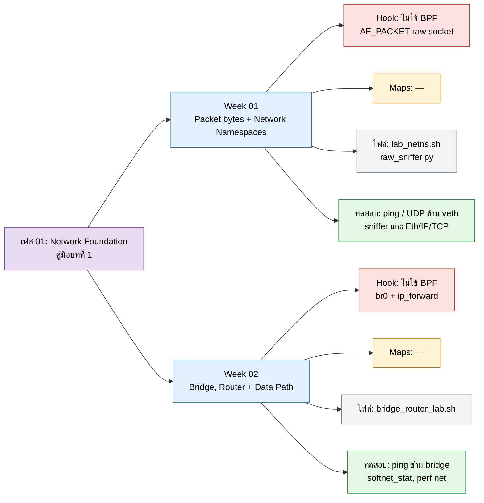

**คู่มือแล็บ:** [Week 01](../phase01-network-foundation/week01-packet-netns/README.md) · [Week 02](../phase01-network-foundation/week02-linux-net-stack/README.md) · **ทฤษฎี:** [MASTER_STUDY_GUIDE บทที่ 1](MASTER_STUDY_GUIDE.md#overview-1)

---

## เฟส 02: First Step into eBPF

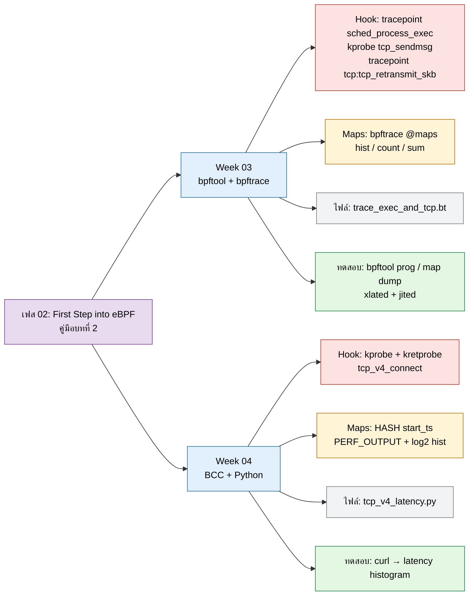

**คู่มือแล็บ:** [Week 03](../phase02-first-step-ebpf/week03-bpftool-bpftrace/README.md) · [Week 04](../phase02-first-step-ebpf/week04-bcc-python/README.md) · **ทฤษฎี:** [MASTER_STUDY_GUIDE บทที่ 2](MASTER_STUDY_GUIDE.md#overview-2)

---

## เฟส 03: Modern eBPF Core (CO-RE)

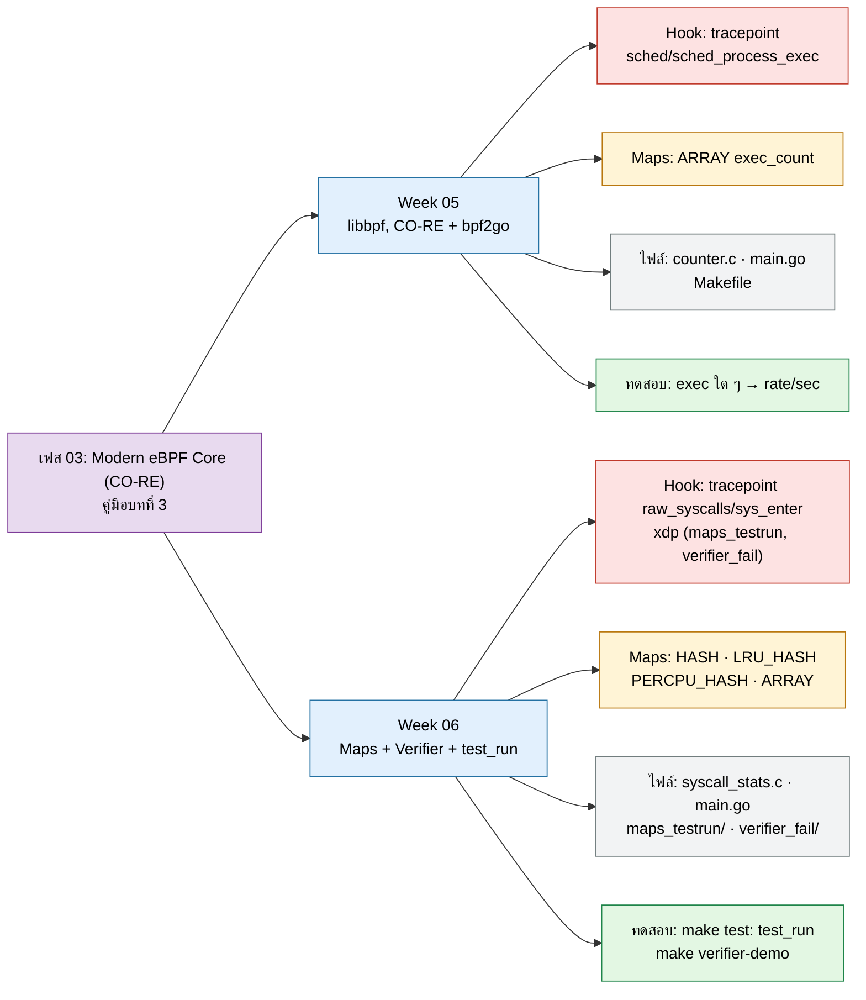

**คู่มือแล็บ:** [Week 05](../phase03-modern-ebpf-core/week05-libbpf-cilium-go/README.md) · [Week 06](../phase03-modern-ebpf-core/week06-ebpf-maps/README.md) · **ทฤษฎี:** [MASTER_STUDY_GUIDE บทที่ 3](MASTER_STUDY_GUIDE.md#overview-3)

---

## เฟส 04: High-Speed Networking

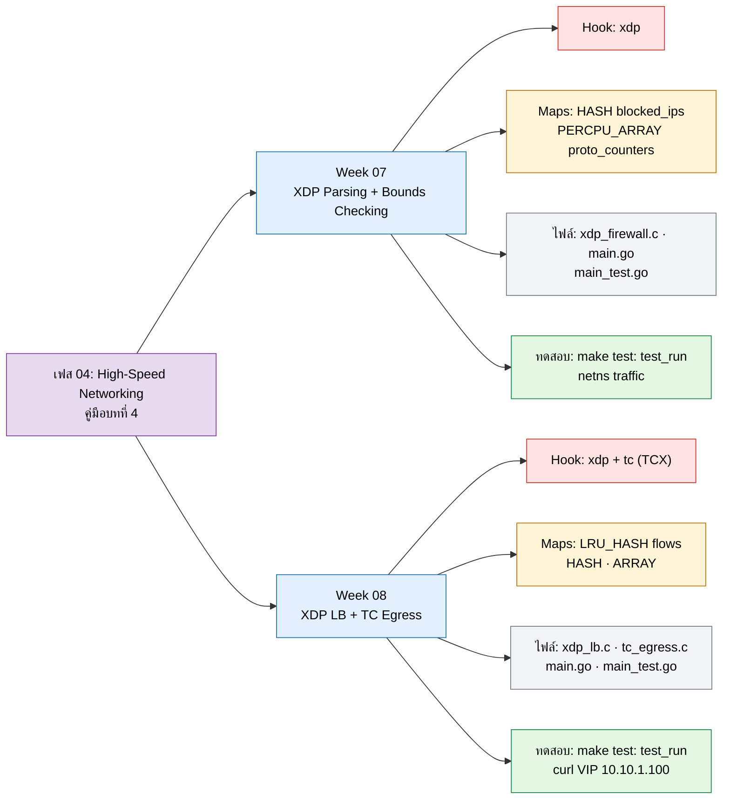

**คู่มือแล็บ:** [Week 07](../phase04-high-speed-networking/week07-xdp-parsing/README.md) · [Week 08](../phase04-high-speed-networking/week08-tc-loadbalancer/README.md) · **ทฤษฎี:** [MASTER_STUDY_GUIDE บทที่ 4](MASTER_STUDY_GUIDE.md#overview-4)

---

## เฟส 05: Security + Observability

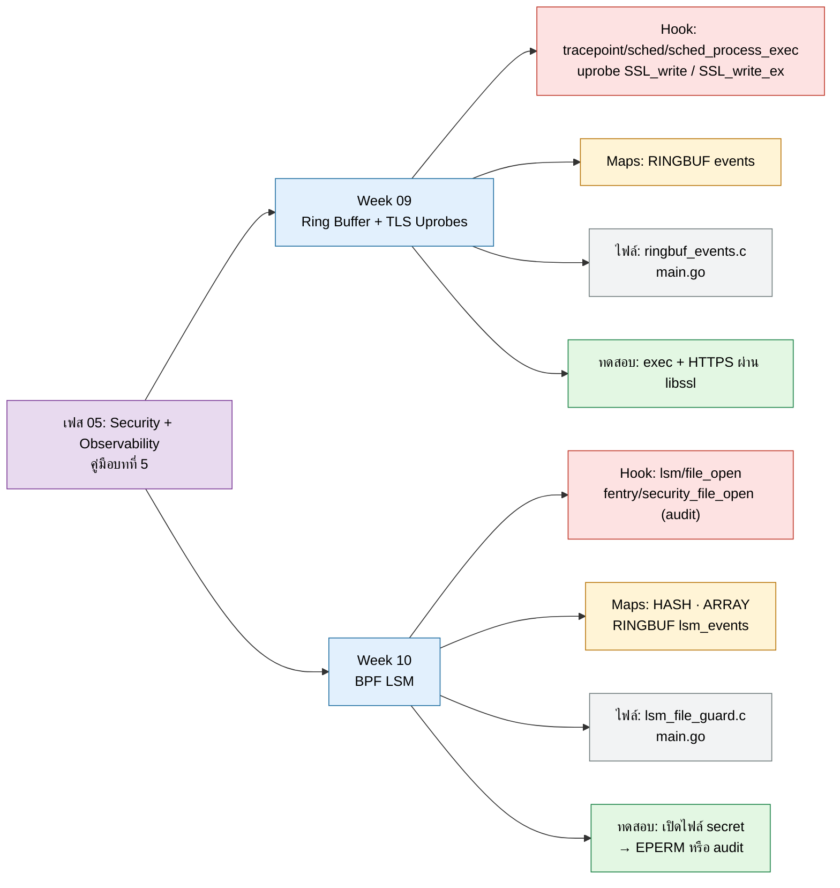

**คู่มือแล็บ:** [Week 09](../phase05-security-observability/week09-ringbuf-uprobes/README.md) · [Week 10](../phase05-security-observability/week10-bpf-lsm/README.md) · **ทฤษฎี:** [MASTER_STUDY_GUIDE บทที่ 5](MASTER_STUDY_GUIDE.md#overview-5)

---

## เฟส 06: Production Capstone

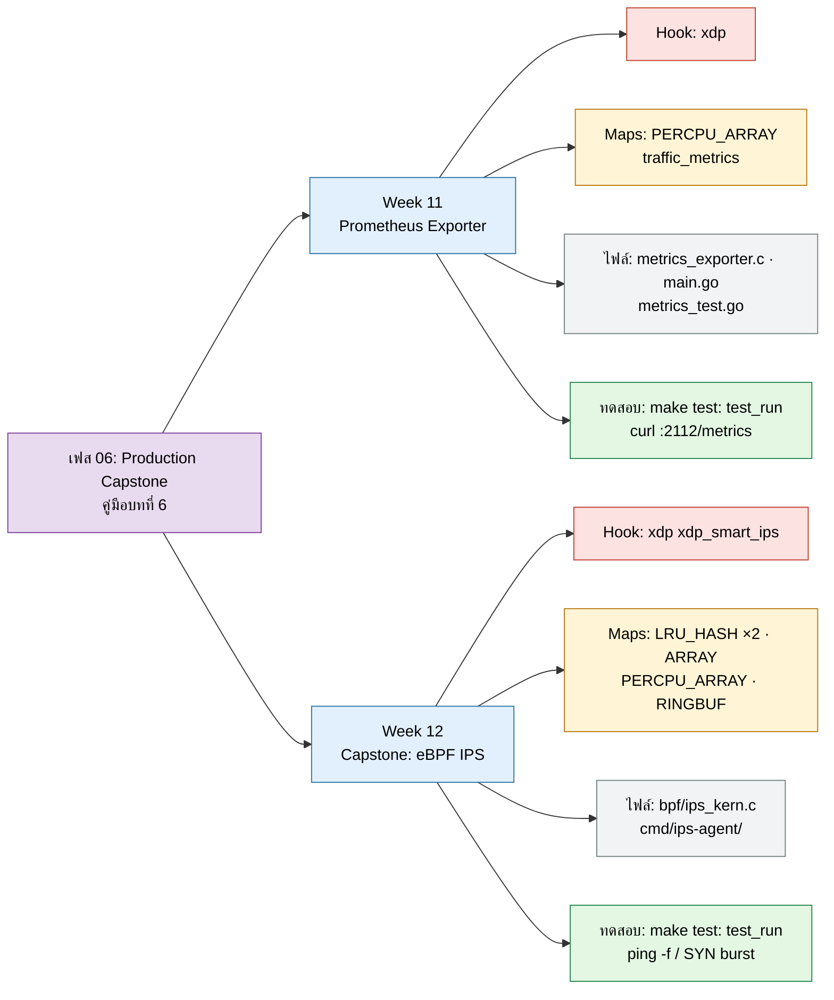

**คู่มือแล็บ:** [Week 11](../phase06-production-capstone/week11-verifier-prometheus/README.md) · [Week 12](../phase06-production-capstone/week12-capstone-ips/README.md) · **ทฤษฎี:** [MASTER_STUDY_GUIDE บทที่ 6](MASTER_STUDY_GUIDE.md#overview-6)

---

## เฟส 07: Advanced Kernel Security

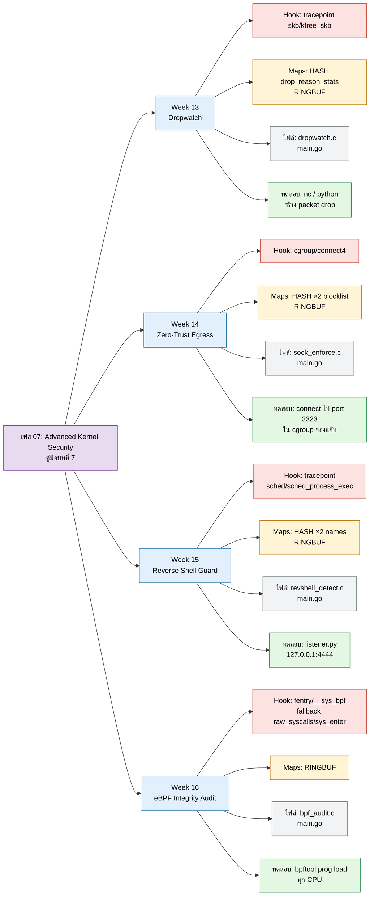

**คู่มือแล็บ:** [Week 13](../phase07-advanced-security-observability/week13-kfree-skb-dropwatch/README.md) · [Week 14](../phase07-advanced-security-observability/week14-cgroup-sock-addr/README.md) · [Week 15](../phase07-advanced-security-observability/week15-reverse-shell-guard/README.md) · [Week 16](../phase07-advanced-security-observability/week16-ebpf-integrity-audit/README.md) · **ทฤษฎี:** [MASTER_STUDY_GUIDE บทที่ 7](MASTER_STUDY_GUIDE.md#overview-7)

---

## เฟส 08: System Performance

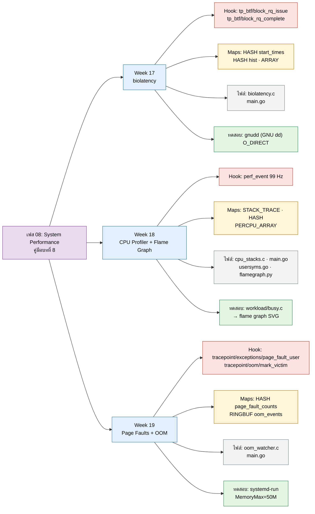

**คู่มือแล็บ:** [Week 17](../phase08-system-performance-observability/week17-block-io-biolatency/README.md) · [Week 18](../phase08-system-performance-observability/week18-cpu-profiler-stacks/README.md) · [Week 19](../phase08-system-performance-observability/week19-memory-oom-watcher/README.md) · **ทฤษฎี:** [MASTER_STUDY_GUIDE บทที่ 8](MASTER_STUDY_GUIDE.md#overview-8)

---

## เฟส 09: Socket Acceleration

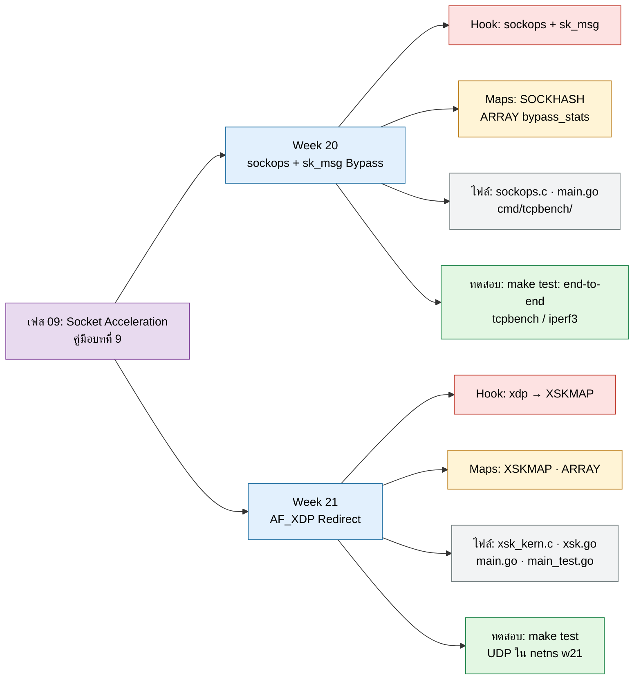

**คู่มือแล็บ:** [Week 20](../phase09-high-throughput-socket-acceleration/week20-tcp-sockops-bypass/README.md) · [Week 21](../phase09-high-throughput-socket-acceleration/week21-af-xdp-redirect/README.md) · **ทฤษฎี:** [MASTER_STUDY_GUIDE บทที่ 9](MASTER_STUDY_GUIDE.md#overview-9)

---

## เฟส 10: Cutting-Edge eBPF

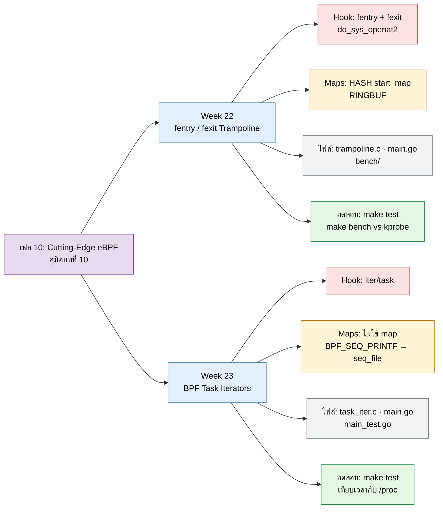

**คู่มือแล็บ:** [Week 22](../phase10-cutting-edge-ebpf-technologies/week22-fentry-fexit-trampoline/README.md) · [Week 23](../phase10-cutting-edge-ebpf-technologies/week23-bpf-iterators/README.md) · **ทฤษฎี:** [MASTER_STUDY_GUIDE บทที่ 10](MASTER_STUDY_GUIDE.md#overview-10)

---

## เฟส 11: Modern Extensibility

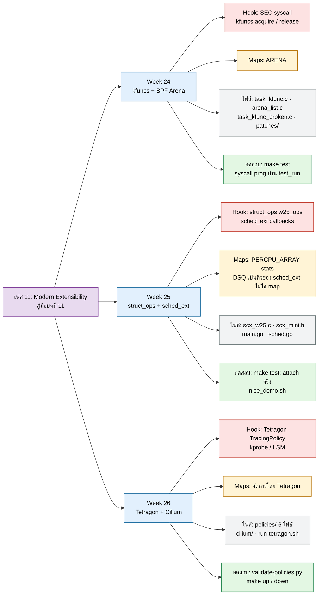

**คู่มือแล็บ:** [Week 24](../phase11-modern-ebpf-extensibility/week24-kfuncs-arena/README.md) · [Week 25](../phase11-modern-ebpf-extensibility/week25-struct-ops-sched-ext/README.md) · [Week 26](../phase11-modern-ebpf-extensibility/week26-ecosystem-tetragon-cilium/README.md) · **ทฤษฎี:** [MASTER_STUDY_GUIDE บทที่ 11](MASTER_STUDY_GUIDE.md#overview-11)

---

*กลับไปที่ [README หลัก](../README.md)*
