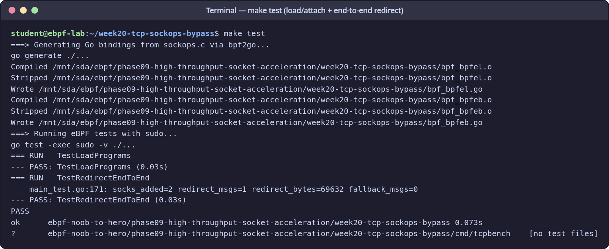
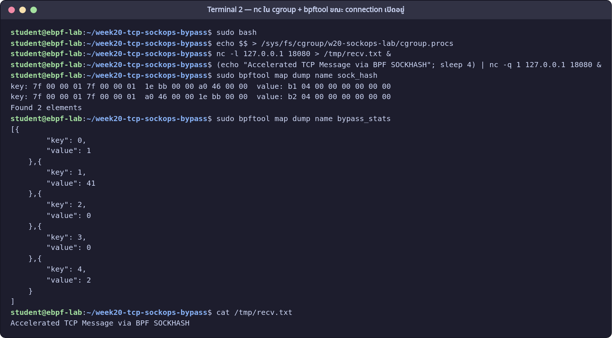
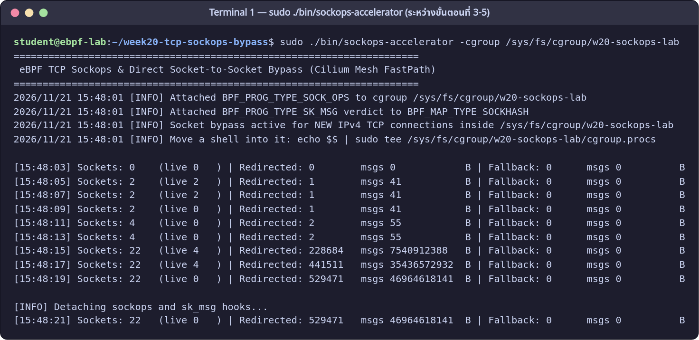
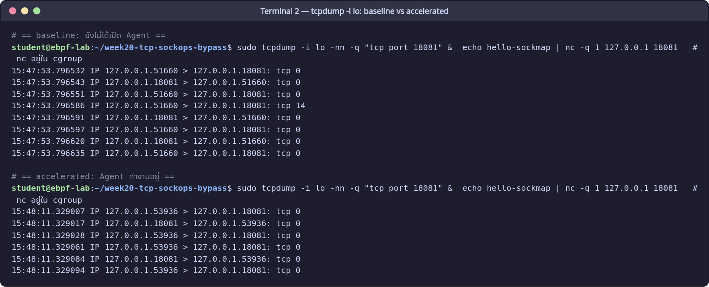
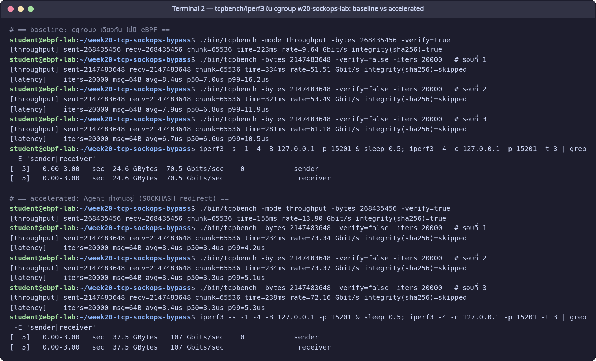

# Week 20: TCP Socket-to-Socket Bypass ด้วย sockops + sk_msg (SOCKHASH Redirect)

**Week 20** (เริ่มต้นเฟส Socket Acceleration) — เร่งความเร็ว TCP ภายในเครื่องด้วย SOCKOPS + `sk_msg`

ในระบบ Microservices / Service Mesh ทราฟฟิกจำนวนมากวิ่งอยู่ **บนเครื่องเดียวกัน** (เช่น Application ↔ Sidecar Proxy อย่าง Envoy หรือ Pod ↔ Pod บน Node เดียวกัน) แต่ทุก `send()` ยังต้องเดินผ่าน TCP/IP Stack เต็มรูปแบบ: สร้าง TCP/IP Header, คำนวณ Checksum (บน loopback ถูกข้ามได้บางส่วน), ผ่าน Netfilter Hooks, ส่งผ่าน `lo` แล้ววนกลับขึ้นมาใน softirq ฝั่งรับ และสร้าง ACK กลับ

สัปดาห์นี้เราจะใช้ **`BPF_PROG_TYPE_SOCK_OPS`** เก็บ Socket ที่เชื่อมต่อแล้วลงใน **`BPF_MAP_TYPE_SOCKHASH`** และใช้ **`BPF_PROG_TYPE_SK_MSG`** ย้าย Payload ของ `sendmsg()` ไปใส่ **Receive Queue ของ Socket ปลายทางโดยตรง** ลัดข้าม TCP/IP Stack ทั้งหมด — แล้ว **วัดผลจริง** ว่าเร็วขึ้นเท่าไร

> [!WARNING]
> เวอร์ชันก่อนหน้าของแล็บนี้มีบั๊กเรื่อง Byte Order ของพอร์ต ทำให้คีย์ฝั่ง `sockops` กับ `sk_msg` ไม่มีวันตรงกัน → `bpf_msg_redirect_hash()` ล้มเหลวทุกครั้ง แต่ Dashboard ยังนับว่า "accelerated" เพราะนับก่อน Redirect บทนี้อธิบายบั๊กดังกล่าวในหัวข้อ 1.4 และโค้ดปัจจุบันแก้แล้ว พร้อม Test ที่พิสูจน์ว่า Redirect เกิดขึ้นจริง

---

## 🗺️ แผนภาพภาพรวมการทำงาน (Workflow Overview)



> **สัญลักษณ์:** 🟥 Kernel Space · 🟦 User Space / เครื่องมือ · 🟨 BPF Map · 🟩 เครือข่าย (netns, veth, แพ็กเก็ต) · ◇ จุดตัดสินใจ

**อ่านแผนภาพ:** Agent สร้าง cgroup `w20-sockops-lab` แล้วแนบ `bpf_sockops_handler()` เข้ากับ cgroup และแนบ `bpf_sk_msg_handler()` เป็น verdict ของ `sock_hash` → เมื่อการเชื่อมต่อ TCP (IPv4) ของโปรเซสใน cgroup สร้างเสร็จ sockops จะบันทึก socket ทั้งฝั่ง client และ server ลง `sock_hash` → ทุก `sendmsg()` จะผ่าน sk_msg ซึ่งสร้าง key ของ socket ปลายทาง (สลับ src/dst) แล้วเรียก `bpf_msg_redirect_hash()`: ถ้าเจอ peer ข้อมูลถูกย้ายเข้า Receive Queue ปลายทาง **ลัดข้าม TCP/IP Stack ทั้งหมด** (เส้นทาง Bypass) ถ้าไม่เจอจะวิ่งผ่าน Stack ปกติ (Fallback) โดยทั้งสองกรณีถูกนับใน `bypass_stats` เพื่อพิสูจน์ว่า redirect เกิดจริง และนำไปเทียบ throughput/latency กับ Baseline ด้วย `tcpbench`/`iperf3`

### ⏱️ ลำดับเหตุการณ์ตามเวลา (Sequence Diagram)



**อ่านแผนภาพ:** งานแบ่งเป็นสองช่วง ช่วงแรกเกิดครั้งเดียวตอน handshake: `sockops` ลงทะเบียน socket ทั้งสองฝั่งใน `sock_hash` ช่วงที่สองเกิดทุกครั้งที่ส่งข้อมูล: `sk_msg` สลับ 4-tuple เพื่อหา socket ของ peer แล้วย้ายข้อมูลเข้าคิวรับของ peer โดยตรง ถ้าหาไม่เจอโปรแกรมยังคืน `SK_PASS` ข้อมูลจึงไปตามเส้นทาง TCP/IP ปกติและไม่สูญหาย

---

## 1. พื้นฐานและหลักการทำงาน (How It Works)

### 1.1 เส้นทางข้อมูล Localhost TCP: ปกติ vs SOCKHASH Redirect



สิ่งที่ถูกลัดข้าม: การสร้าง/ประมวลผล TCP Segment, ACK, IP Routing, Netfilter, การส่งผ่าน `lo` และ softirq ฝั่งรับ — ส่วน **Handshake (SYN/SYN-ACK/ACK) และ FIN ยังวิ่งผ่าน Stack ปกติ** เพราะ Redirect ทำงานเฉพาะ Payload ของ `sendmsg()` (เราพิสูจน์ด้วย `tcpdump` ในหัวข้อ 4.4)

> [!NOTE]
> **นี่ไม่ใช่ Zero-Copy** — ข้อมูลยังถูก Copy จาก User → Kernel (`sk_msg`) หนึ่งครั้ง และ Kernel → User อีกหนึ่งครั้งตอน `recvmsg()` เท่ากับ TCP ปกติ สิ่งที่ประหยัดคือ **งานประมวลผลโปรโตคอล** ไม่ใช่การ Copy หน่วยความจำ

### 1.2 `BPF_PROG_TYPE_SOCK_OPS`: Hook วงจรชีวิตของ TCP Connection

โปรแกรม `sockops` ถูกแนบกับ **cgroup v2** (`BPF_CGROUP_SOCK_OPS`) และถูกเรียกเมื่อ Socket ของ Process ใน cgroup นั้นเกิดเหตุการณ์ TCP ต่าง ๆ โดย `skops->op` บอกชนิดของเหตุการณ์ เช่น:

| `op` | เกิดเมื่อ |
|------|-----------|
| `BPF_SOCK_OPS_ACTIVE_ESTABLISHED_CB` | ฝั่ง Client (`connect()`) Handshake สำเร็จ |
| `BPF_SOCK_OPS_PASSIVE_ESTABLISHED_CB` | ฝั่ง Server (Socket ที่ได้จาก `accept()`) Handshake สำเร็จ |
| `BPF_SOCK_OPS_STATE_CB`, `RTO_CB`, ... | ต้องเปิดด้วย `bpf_sock_ops_cb_flags_set()` ก่อน |

ทั้งสองฝั่งของ Connection ต้องอยู่ใน cgroup ที่แนบโปรแกรมไว้ ไม่เช่นนั้นจะมีแค่ฝั่งเดียวใน Map และ Redirect จะหาคู่ไม่เจอ

### 1.3 `SOCKHASH` + `SK_MSG`: กลไก Redirect

- `bpf_sock_hash_update(skops, &sock_hash, &key, BPF_NOEXIST)` — ใส่ Socket ลง Map ด้วยคีย์ 4-tuple ขณะใส่ เคอร์เนลจะสร้าง **psock** และเปลี่ยน `sk->sk_prot` ของ Socket เป็น `tcp_bpf_prots` ทำให้ `sendmsg()`/`recvmsg()` ของ Socket นั้นไหลผ่านโค้ดของ BPF
- โปรแกรม `sk_msg` ไม่ได้แนบกับ cgroup แต่แนบกับ **ตัว Map** (`BPF_SK_MSG_VERDICT`) จึงทำงานกับทุก Socket ที่อยู่ใน Map
- `bpf_msg_redirect_hash(msg, &sock_hash, &key, BPF_F_INGRESS)` — หา Socket ปลายทางด้วย `key` แล้วย้ายข้อมูลไปไว้ใน **Ingress Queue** (`BPF_F_INGRESS`) ของ Socket นั้น ให้แอปฝั่งรับอ่านได้ด้วย `recv()` ตามปกติ คืน `SK_PASS` เมื่อสำเร็จ และ `SK_DROP` เมื่อหาคีย์ไม่เจอ
- เมื่อ Application ปิด Socket เคอร์เนลจะ **ลบ Entry ออกจาก SOCKHASH อัตโนมัติ** (เห็นได้จากคอลัมน์ `live` ใน Dashboard)

### 1.4 กับดัก Byte Order ของพอร์ต (บั๊กที่แก้ในบทนี้)

UAPI ของ `struct bpf_sock_ops` และ `struct sk_msg_md` เก็บพอร์ตสองฝั่ง **ไม่เหมือนกัน**:

| ฟิลด์ | Byte Order | ค่าที่อ่านได้บน x86_64 (พอร์ต 18080 = `0x46a0`) |
|-------|-----------|-------------------------------------------|
| `local_ip4`, `remote_ip4` | Network | `0x0100007f` (127.0.0.1) |
| `local_port` | **Host** | `0x000046a0` |
| `remote_port` | **Network** (อยู่ใน 16 บิตบนบน Little-Endian) | `0xa0460000` |
| `bpf_ntohl(remote_port)` | Host | `0x000046a0` |

โค้ดเดิมเก็บคีย์ฝั่ง `sockops` เป็น `sport = bpf_ntohl(local_port)` (= `0xa0460000`) แต่ฝั่ง `sk_msg` ค้นหาด้วย `sport = remote_port >> 16` (= `0x0000a046`) ค่าต่างกัน → ไม่มีวันเจอ และยัง **นับสถิติก่อน Redirect** ทำให้ Dashboard บอกว่า "Accelerated" ทั้งที่ทุกข้อความวิ่งผ่าน TCP Stack ปกติ

**หลักการแก้:** เลือก Encoding เดียวแล้วใช้ให้ตรงกันทั้งสองโปรแกรม — บทนี้ใช้ **Host Order** สำหรับพอร์ต (`local_port` ตรง ๆ, `bpf_ntohl(remote_port)`) และ **นับเฉพาะเมื่อ Redirect สำเร็จ** แยกจาก Fallback

### 1.5 คีย์กลับด้าน (Reverse 4-tuple)

Socket ฝั่ง Client ลงทะเบียน `{sip=C, dip=S, sport=Cp, dport=Sp}` ส่วน Socket ฝั่ง Server ลงทะเบียน `{sip=S, dip=C, sport=Sp, dport=Cp}` เมื่อ Client ส่งข้อมูล โปรแกรม `sk_msg` (ซึ่งเห็นมุมมองของ Client) ต้อง **สลับ local/remote** เพื่อหา Socket ของ Server:

```
Client sk_msg เห็น: local=C:Cp  remote=S:Sp
คีย์ที่ค้นหา      : sip=S  dip=C  sport=Sp  dport=Cp   ==  คีย์ของ Server socket
```

---

## 2. อธิบายโค้ดทีละบรรทัด (Line-by-Line Code Breakdown)

### 2.1 ไฟล์ `sockops.c`

```c
struct sock_key {
    __u32 sip;
    __u32 dip;
    __u32 sport;
    __u32 dport;
};
```
- **บรรทัด 24-29:** คีย์ 4-tuple ขนาด 16 ไบต์ คอมเมนต์ด้านบน (บรรทัด 12-23) ระบุ Encoding ที่ต้องใช้ให้ตรงกันทั้งสองโปรแกรม: IP เป็น Network Order, พอร์ตเป็น Host Order

```c
struct {
    __uint(type, BPF_MAP_TYPE_SOCKHASH);
    __uint(max_entries, 65535);
    __type(key, struct sock_key);
    __type(value, __u64);
} sock_hash SEC(".maps");
```
- **บรรทัด 34-39:** SOCKHASH เก็บ "การอ้างอิง Socket" ฝั่ง Userspace อ่านค่า Value ได้เป็น Socket Cookie (`__u64`) ซึ่งเห็นได้ใน `bpftool map dump`

```c
enum {
    STAT_REDIRECT_MSGS  = 0,
    STAT_REDIRECT_BYTES = 1,
    STAT_FALLBACK_MSGS  = 2,
    STAT_FALLBACK_BYTES = 3,
    STAT_SOCKS_ADDED    = 4,
    STAT_MAX,
};
```
- **บรรทัด 44-51:** ดัชนีของ `bypass_stats` (Array 5 ช่อง) แยก "Redirect สำเร็จ" ออกจาก "Fallback" ชัดเจน ฝั่ง Go มีค่าคงที่ชุดเดียวกันใน `main.go`

```c
        struct sock_key key = {
            .sip = skops->local_ip4,
            .dip = skops->remote_ip4,
            .sport = skops->local_port,
            .dport = bpf_ntohl(skops->remote_port),
        };
        if (bpf_sock_hash_update(skops, &sock_hash, &key, BPF_NOEXIST) == 0) {
            stat_add(STAT_SOCKS_ADDED, 1);
        }
```
- **บรรทัด 82-92:** เมื่อ Connection Established (ทั้ง Active/Passive, บรรทัด 81) สร้างคีย์จากมุมมองของ Socket ตัวเอง — `local_port` เป็น Host Order อยู่แล้ว ส่วน `remote_port` ต้อง `bpf_ntohl()` จากนั้นใส่ลง SOCKHASH และนับจำนวน Socket ที่ลงทะเบียนสำเร็จ

```c
    struct sock_key key = {
        .sip = msg->remote_ip4,
        .dip = msg->local_ip4,
        .sport = bpf_ntohl(msg->remote_port),
        .dport = msg->local_port,
    };
```
- **บรรทัด 113-118:** คีย์กลับด้าน (หัวข้อ 1.5) ใช้ Encoding เดียวกับฝั่ง `sockops` ทุกประการ

```c
    long ret = bpf_msg_redirect_hash(msg, &sock_hash, &key, BPF_F_INGRESS);
    if (ret == SK_PASS) {
        stat_add(STAT_REDIRECT_MSGS, 1);
        stat_add(STAT_REDIRECT_BYTES, msg->size);
        return SK_PASS;
    }

    stat_add(STAT_FALLBACK_MSGS, 1);
    stat_add(STAT_FALLBACK_BYTES, msg->size);
    return SK_PASS;
```
- **บรรทัด 127-136:** นับสถิติ **หลัง** ทราบผล Redirect เท่านั้น ถ้าหา Peer ไม่เจอ (เช่น ปลายทางอยู่นอกเครื่อง หรือ Connection เกิดก่อนแนบโปรแกรม) ให้คืน `SK_PASS` เพื่อส่งผ่าน TCP Stack ปกติ — ห้ามคืน `SK_DROP` เพราะจะทำให้ข้อมูลหาย

### 2.2 ไฟล์ `main.go`

```go
	cgroupPath := flag.String("cgroup", "/sys/fs/cgroup/w20-sockops-lab", "Target cgroup v2 path (created if missing)")
```
- **บรรทัด 58:** ค่าเริ่มต้นเป็น cgroup ลูกเฉพาะแล็บ **ไม่ใช่** `/sys/fs/cgroup` (root) เพราะถ้าแนบที่ root ทุก TCP Socket ของเครื่อง (SSH, Docker, ฯลฯ) จะถูกเปลี่ยนเส้นทางข้อมูล บรรทัด 70-76 สร้าง cgroup ให้ถ้ายังไม่มี

```go
	cgroupLink, err := link.AttachCgroup(link.CgroupOptions{
		Path:    *cgroupPath,
		Attach:  ebpf.AttachCGroupSockOps,
		Program: objs.BpfSockopsHandler,
	})
```
- **บรรทัด 85-89:** แนบ `sockops` เข้ากับ cgroup ด้วย BPF Link (ถอดอัตโนมัติเมื่อ Process จบ)

```go
	attachOpts := link.RawAttachProgramOptions{
		Target:  objs.SockHash.FD(),
		Program: objs.BpfSkMsgHandler,
		Attach:  ebpf.AttachSkMsgVerdict,
	}
	if err := link.RawAttachProgram(attachOpts); err != nil {
```
- **บรรทัด 97-102:** แนบ `sk_msg` เข้ากับ **FD ของ Map** (`BPF_PROG_ATTACH` แบบดั้งเดิม เพราะ Program ชนิดนี้ไม่ได้ผูกกับ cgroup/อินเทอร์เฟซ)

```go
func countSockhashEntries(m *ebpf.Map) int {
	var key, next bpfSockKey
	n := 0
	err := m.NextKey(nil, &next)
	for err == nil {
```
- **บรรทัด 43-53:** นับ Entry ที่ยังอยู่ใน SOCKHASH ด้วย `BPF_MAP_GET_NEXT_KEY` (คอลัมน์ `live`) เปรียบเทียบกับ `Sockets:` ที่เป็นยอดสะสม ทำให้เห็นว่าเคอร์เนลลบ Socket ที่ปิดแล้วเอง

```go
	printStats := func() {
		fmt.Printf("[%s] Sockets: %-4d (live %-4d) | Redirected: ... | Fallback: ...\n", ...)
```
- **บรรทัด 117-126:** Dashboard ทุก 2 วินาที แสดง Redirect และ Fallback แยกกัน — ถ้า `Fallback` เพิ่มขึ้นขณะที่ `Redirected` ไม่ขยับ แปลว่าคีย์ไม่ตรงกันหรือ Peer ไม่ได้อยู่ใน cgroup

### 2.3 ไฟล์ `cmd/tcpbench/main.go` (เครื่องมือวัดผล)

- รัน **Server และ Client ใน Process เดียวกัน** เพื่อให้ย้ายเข้า cgroup ทีเดียวแล้วทั้งสองฝั่งถูก `sockops` จับ
- `runThroughput()`: ส่งข้อมูลสุ่มแบบ Seed คงที่ ขนาด `-bytes` ทีละ `-chunk` ไบต์ ถ้า `-verify=true` ทั้งสองฝั่งคำนวณ SHA-256 เพื่อพิสูจน์ว่าข้อมูลที่ถูก Redirect **ครบและไม่เสียหาย** (`-verify=false` สำหรับวัดความเร็วล้วน เพราะ SHA-256 กิน CPU)
- `runLatency()`: Ping-pong ข้อความ `-msg` ไบต์ จำนวน `-iters` รอบ รายงาน avg/p50/p99 ของ Round-Trip Time และตรวจว่า Echo ตรงกับที่ส่ง

### 2.4 ไฟล์ `main_test.go`

Program ชนิด `sockops`/`sk_msg` **ไม่รองรับ `BPF_PROG_TEST_RUN`** จึงทดสอบด้วยเคอร์เนลจริง:
- `TestLoadPrograms`: Smoke Test — ผ่าน Verifier และชนิด Program/Map ถูกต้อง
- `TestRedirectEndToEnd`: สร้าง cgroup ชั่วคราว `w20-gotest-<pid>` แนบทั้งสองโปรแกรม ย้าย Test Process เข้า cgroup เปิด TCP Connection บน `127.0.0.1` ส่ง 68 KiB แล้วตรวจว่า (1) SOCKHASH มี 2 Entry (2) `redirect_bytes` เท่ากับขนาดที่ส่งและ `fallback == 0` (3) ข้อมูลที่รับตรงกันทุกไบต์ จากนั้นย้าย Process กลับและลบ cgroup

---

## 3. ขั้นตอนการรันและทดสอบ (Step-by-Step Execution & Verification)

### ขั้นตอนที่ 1: คอมไพล์โปรแกรมและรัน Test
```bash
cd phase09-high-throughput-socket-acceleration/week20-tcp-sockops-bypass
make all     # bpf2go + build bin/sockops-accelerator และ bin/tcpbench
make test    # go test -exec sudo -v ./...
```

### ขั้นตอนที่ 2: เปิด Agent บน cgroup เฉพาะแล็บ (Terminal 1)
```bash
sudo ./bin/sockops-accelerator -cgroup /sys/fs/cgroup/w20-sockops-lab
```

### ขั้นตอนที่ 3: ย้าย Shell เข้า cgroup แล้วทดสอบด้วย `nc` (Terminal 2)
```bash
sudo bash                                            # shell ที่เป็น root
echo $$ > /sys/fs/cgroup/w20-sockops-lab/cgroup.procs  # ทุก process ลูกจะอยู่ใน cgroup นี้

nc -l 127.0.0.1 18080 &                              # server
(echo "Accelerated TCP Message via BPF SOCKHASH"; sleep 2) | nc -q 1 127.0.0.1 18080
```

### ขั้นตอนที่ 4: ตรวจสอบ SOCKHASH และตัวนับด้วย `bpftool` (ขณะ Connection ยังเปิดอยู่)
```bash
sudo bpftool map dump name sock_hash      # ต้องเห็น 2 entries (client + server)
sudo bpftool map dump name bypass_stats   # key 0 (redirect msgs) > 0, key 2 (fallback) = 0
```

### ขั้นตอนที่ 5: เปรียบเทียบประสิทธิภาพ (ใน shell ที่อยู่ใน cgroup)
```bash
# 1) ตรวจความถูกต้องของข้อมูล
./bin/tcpbench -mode throughput -bytes 268435456 -verify=true
# 2) วัดความเร็ว (รันหลายรอบ แล้วดูค่ากลาง)
./bin/tcpbench -bytes 2147483648 -verify=false -iters 20000
# 3) iperf3 (sudo apt-get install -y iperf3)
iperf3 -s -1 -4 -B 127.0.0.1 -p 15201 & sleep 0.5; iperf3 -4 -c 127.0.0.1 -p 15201 -t 3
```
จากนั้นกด `Ctrl+C` ที่ Agent (Terminal 1) แล้วรันคำสั่งชุดเดิมซ้ำใน cgroup เดิมเพื่อได้ค่า **Baseline** (ไม่มี eBPF)

### ขั้นตอนที่ 6: คืนค่าสภาพแวดล้อม
```bash
exit                                       # ออกจาก shell ที่อยู่ใน cgroup
sudo rmdir /sys/fs/cgroup/w20-sockops-lab  # ลบได้เมื่อไม่มี process เหลือใน cgroup
```

---

## 4. ผลลัพธ์จากการทดลองจริง (Actual Lab Execution Output)

> **Environment**: Ubuntu 26.04 LTS (`Linux 7.0.0-43-generic x86_64`), Intel Core i3-12100 (8 threads), clang 21, Go 1.26, cilium/ebpf v0.16.0

<!-- screenshots:begin -->

### 📸 ภาพหน้าจอจากการรันจริง (Real Terminal Screenshots)

> รันจริงบน `Linux 7.0.0-43-generic` (Ubuntu 26.04) เมื่อ 2026-11-21 ด้วยสคริปต์ [`scripts/screenshots/week20.sh`](../../scripts/screenshots/week20.sh) ทุกบรรทัดในภาพมาจากคำสั่งจริง (render เป็นภาพด้วย `scripts/screenshots/render.py`) ค่าอย่าง PID, เวลา และ latency จะเปลี่ยนทุกครั้งที่รัน

ภาพหน้าจออยู่ในหัวข้อย่อยที่ตรงกันด้านล่าง แทน output แบบข้อความเดิม

<!-- screenshots:end -->

### 4.1 `make test`



*ภาพ: `make test` — โหลด/แนบโปรแกรม และทดสอบ Redirect แบบ End-to-End (`socks_added=2 redirect_bytes=69632 fallback_msgs=0`)*

### 4.2 `nc` + `bpftool` ขณะ Connection เปิดอยู่



*ภาพ: Terminal 2 — `nc` ใน cgroup + `bpftool` ขณะ Connection เปิดอยู่*

สังเกตคีย์: `a0 46 00 00` คือ `0x000046a0` = 18080 (พอร์ต Server ใน Host Order แบบ Little-Endian) และ `1e bb 00 00` = `0xbb1e` = 47902 (พอร์ตชั่วคราวของ Client) — สองคีย์เป็นภาพสะท้อนของกันและกัน (หัวข้อ 1.5) ส่วน Value คือ Socket Cookie

### 4.3 Dashboard ของ Agent (ระหว่างขั้นตอนที่ 3-5)



*ภาพ: Terminal 1 — Dashboard ของ `sockops-accelerator` ระหว่างขั้นตอนที่ 3-5*

(`live 2` ระหว่าง `nc` = Socket ฝั่ง Client + Server, `live 4` ระหว่าง iperf3 = Control Connection + Data Connection อย่างละ 2 Socket)

### 4.4 พิสูจน์ด้วย `tcpdump -i lo`: Payload ไม่ผ่าน Loopback อีกต่อไป
ส่ง `hello-sockmap` (14 ไบต์) ด้วย `nc` ใน cgroup เดียวกัน แล้วดักที่ `lo` (`tcpdump -i lo -nn -q "tcp port 18081"`):



*ภาพ: Terminal 2 — `tcpdump -i lo` ก่อนและหลังเปิด Agent*

เมื่อเปิด Agent Segment `tcp 14` (Payload) และ ACK ของมันหายไป เหลือเพียง Handshake และ FIN — **เครื่องมือที่ดักบน `lo` (tcpdump, Netfilter) จะมองไม่เห็นข้อมูลที่ถูก Redirect**

### 4.5 ผลการวัดประสิทธิภาพ (Baseline vs Accelerated)

ทุกค่ารันใน cgroup เดียวกัน (`w20-sockops-lab`) บนเครื่องเดียวกัน ต่างกันแค่มี/ไม่มี Agent:



*ภาพ: Terminal 2 — `tcpbench`/`iperf3` ใน cgroup `w20-sockops-lab`: baseline vs accelerated*

สรุป (ค่ากลาง/Median จากภาพด้านบน):

| ตัวชี้วัด | Baseline (TCP ปกติ) | SOCKHASH Redirect | ต่าง |
|-----------|--------------------|-------------------|------|
| tcpbench throughput (64 KiB writes, 2 GiB × 3 รอบ) | 53.5 Gbit/s (51.5–61.2) | 73.3 Gbit/s (72.2–73.4) | ≈ +37% |
| iperf3 throughput (1 stream, 3 s × 1 รอบ) | 70.5 Gbit/s | 107 Gbit/s | ≈ +52% |
| Latency RTT 64 B p50 (20,000 รอบ × 3) | 6.8 µs | 3.3 µs | ≈ −51% |

> [!IMPORTANT]
> ตัวเลขเหล่านี้มาจาก **เครื่องเดียว, Loopback, Single Stream, CPU Frequency Scaling ไม่ได้ล็อก** มีความแปรปรวนสูง (ดูช่วง min–max) ใช้เพื่อเห็น **แนวโน้ม** เท่านั้น ไม่ใช่ตัวเลขที่ใช้อ้างอิงได้กับทุกระบบ ผลจริงขึ้นกับ CPU, ขนาดข้อความ, จำนวน Connection และรุ่นเคอร์เนล

---

## 5. ข้อจำกัด (Limitations)

- **IPv4 เท่านั้น** (`family != AF_INET` ถูกข้าม) — IPv6 ต้องเพิ่ม `local_ip6`/`remote_ip6` ในคีย์
- **ทั้งสองปลายต้องอยู่บนเครื่องเดียวกันและอยู่ใน cgroup ที่แนบโปรแกรม** ถ้าปลายทางอยู่นอกเครื่อง จะเกิด Fallback (`SK_PASS`) ทุกข้อความ แต่ Socket ก็ยังถูกใส่ใน SOCKHASH และจ่าย Overhead ของ psock อยู่ดี
- **เฉพาะ Connection ที่ Established หลังแนบโปรแกรม** — Connection เดิมไม่ถูกเร่ง
- **ข้ามเครื่องมือ Observability/Policy ระดับ Packet:** tcpdump, Netfilter/iptables, tc บน `lo` มองไม่เห็น Payload ที่ถูก Redirect (หัวข้อ 4.4) — นโยบายความปลอดภัยที่พึ่งพาสิ่งเหล่านี้จะถูกข้ามไป
- **ไม่ใช่ Zero-Copy** (หัวข้อ 1.1) — ยังมี Copy 2 ครั้งเหมือน TCP ปกติ
- **การถอด Agent:** เมื่อ Agent ปิด Map ถูกทำลาย Socket จะกลับไปใช้ TCP ปกติ; ไม่ได้ Pin Map ไว้ใน bpffs จึงไม่ได้ทำงานต่อหลัง Agent ตาย
- **ประวัติในระบบจริง:** Cilium เคยมีฟีเจอร์ sockops/sockmap acceleration (`sockops-enable`) แต่ถูกเลิกใช้/ถอดออกในรุ่นหลัง ๆ — โปรดตรวจสอบเอกสารและ Release Notes ของ Cilium รุ่นที่ใช้ก่อนอ้างอิง

---

## 6. Milestone Checklist

- [x] อธิบายเส้นทางข้อมูล Loopback TCP ปกติ เทียบกับ SOCKHASH Redirect และระบุได้ว่าส่วนใดถูกลัดข้าม (และส่วนใดไม่ถูกลัด)
- [x] แนบ `BPF_PROG_TYPE_SOCK_OPS` กับ cgroup v2 เฉพาะแล็บ และเข้าใจ `ACTIVE/PASSIVE_ESTABLISHED_CB`
- [x] แนบ `BPF_PROG_TYPE_SK_MSG` กับ SOCKHASH และใช้ `bpf_msg_redirect_hash(..., BPF_F_INGRESS)`
- [x] เข้าใจกับดัก Byte Order ของ `local_port` (Host) / `remote_port` (Network) และออกแบบคีย์ให้ตรงกันทั้งสองฝั่ง
- [x] นับสถิติเฉพาะเมื่อ Redirect สำเร็จ และแยกตัวนับ Fallback
- [x] พิสูจน์ด้วย `bpftool`, `tcpdump` และ Test อัตโนมัติว่า Redirect เกิดขึ้นจริงและข้อมูลครบถ้วน
- [x] วัด Throughput/Latency แบบมี Baseline และรายงานตัวเลขพร้อมข้อจำกัด

---

## 🛠️ การแก้ปัญหาที่พบบ่อย (Troubleshooting)

| อาการ | สาเหตุ / วิธีแก้ |
|---|---|
| `bpftool map dump name sock_hash` ว่างหรือ `fallback` เพิ่มขึ้นและ `redirected = 0` | ไคลเอนต์หรือเซิร์ฟเวอร์ไม่ได้รันอยู่ใน cgroup `/sys/fs/cgroup/w20-sockops-lab`, เชื่อมต่อก่อนเปิด `sockops-accelerator`, หรือใช้ IPv6 (`[::1]`) แทน IPv4 (`127.0.0.1`) |
| `tcpdump -i lo` ไม่เห็นข้อความจาก `nc` แล้วคิดว่าโปรแกรมเสีย | **นี่คือผลที่ถูกต้อง:** `sk_msg` ทำ `BPF_F_INGRESS` redirect ข้าม TCP/IP stack และ loopback driver จึงไม่ผ่านจุดดักของ `tcpdump` |
| `make test` ล้มเหลว `permission denied` | โปรแกรม `SOCK_OPS` และ `SK_MSG` ต้องใช้ root/`CAP_BPF`+`CAP_NET_ADMIN` — รันผ่าน `make test` (ซึ่งใช้ `go test -exec sudo`) ไม่ใช่ `go test ./...` ตรงๆ |
| `sudo rmdir /sys/fs/cgroup/w20-sockops-lab` ล้มเหลว `Device or resource busy` | ยังมี shell หรือโปรเซส (เช่น `nc &` หรือ `iperf3 -s`) อยู่ใน `cgroup.procs` — ปิดโปรเซสเหล่านั้นหรือพิมพ์ `exit` ออกจาก sub-shell ก่อนลบ |

---

## 7. แบบฝึกหัดท้ายบท (Exercises)

### ระดับพื้นฐาน
1. **ทำซ้ำบั๊กเดิม:** เปลี่ยน `.sport = skops->local_port` กลับเป็น `bpf_ntohl(skops->local_port)` แล้ว `make all && make test`
   - *Deliverable:* ผลลัพธ์ `make test` และ Dashboard ขณะส่งข้อความด้วย `nc`
   - *Verification:* `TestRedirectEndToEnd` ต้อง FAIL ด้วย `fallback msgs = N, want 0` และ Dashboard แสดง `Redirected: 0` แต่ `Fallback` เพิ่มขึ้น (จากนั้นแก้กลับ)
2. **Connection ข้าม cgroup:** รัน `nc -l` ใน cgroup ของแล็บ แต่รัน Client จาก Shell ที่ **ไม่ได้** อยู่ใน cgroup
   - *Deliverable:* `bpftool map dump name sock_hash` และบรรทัด Dashboard
   - *Verification:* SOCKHASH มีเพียง 1 Entry (ฝั่ง Server) และข้อความจาก Client ไม่ถูกนับเป็น Redirect

### ระดับปานกลาง
1. **Per-socket Statistics:** เปลี่ยน `bypass_stats` เป็น `BPF_MAP_TYPE_PERCPU_ARRAY` (ลด Cache-line Bouncing ตาม Week 07) และรวมค่าใน Go
   - *Deliverable:* โค้ดที่แก้ + ผล tcpbench 5 รอบ
   - *Verification:* `make test` ผ่าน, Dashboard ยังแสดงยอดถูกต้อง และเปรียบเทียบ Throughput กับตาราง 4.5
2. **ผลของขนาดข้อความ:** รัน `tcpbench -chunk` ที่ 64 B, 1 KiB, 16 KiB, 64 KiB ทั้ง Baseline และ Accelerated
   - *Deliverable:* ตารางหรือกราฟ Throughput เทียบขนาด Chunk
   - *Verification:* แต่ละจุดมีอย่างน้อย 3 รอบ พร้อมค่า min/median/max และอธิบายว่าขนาดใดได้ประโยชน์มากที่สุดเพราะอะไร

### ระดับท้าทาย
1. **รองรับ IPv6:** เพิ่ม Map/คีย์สำหรับ `AF_INET6` (`local_ip6[4]`, `remote_ip6[4]`) ทั้งสองโปรแกรม
   - *Deliverable:* โค้ด + Test ใหม่ `TestRedirectEndToEndIPv6` ที่เชื่อมต่อ `[::1]`
   - *Verification:* Test ใหม่ผ่าน และ `redirect_bytes` เท่ากับขนาดข้อมูลที่ส่ง
2. **Policy-aware Redirect:** เพิ่ม `BPF_MAP_TYPE_HASH` เก็บพอร์ตที่ "อนุญาตให้เร่ง" ให้ `sk_msg` Redirect เฉพาะพอร์ตใน Map (ที่เหลือ Fallback) และให้ Agent รับ `-ports 18080,15201`
   - *Deliverable:* โค้ด + Dashboard ที่รัน nc บนพอร์ตที่อนุญาตและไม่อนุญาตพร้อมกัน
   - *Verification:* พอร์ตที่อนุญาตเพิ่ม `Redirected`, พอร์ตอื่นเพิ่ม `Fallback`, และ `tcpdump -i lo` เห็น Payload เฉพาะของพอร์ตที่ไม่อนุญาต
