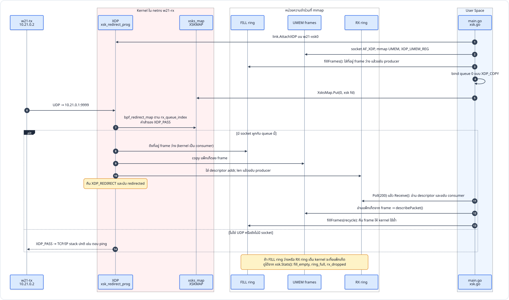
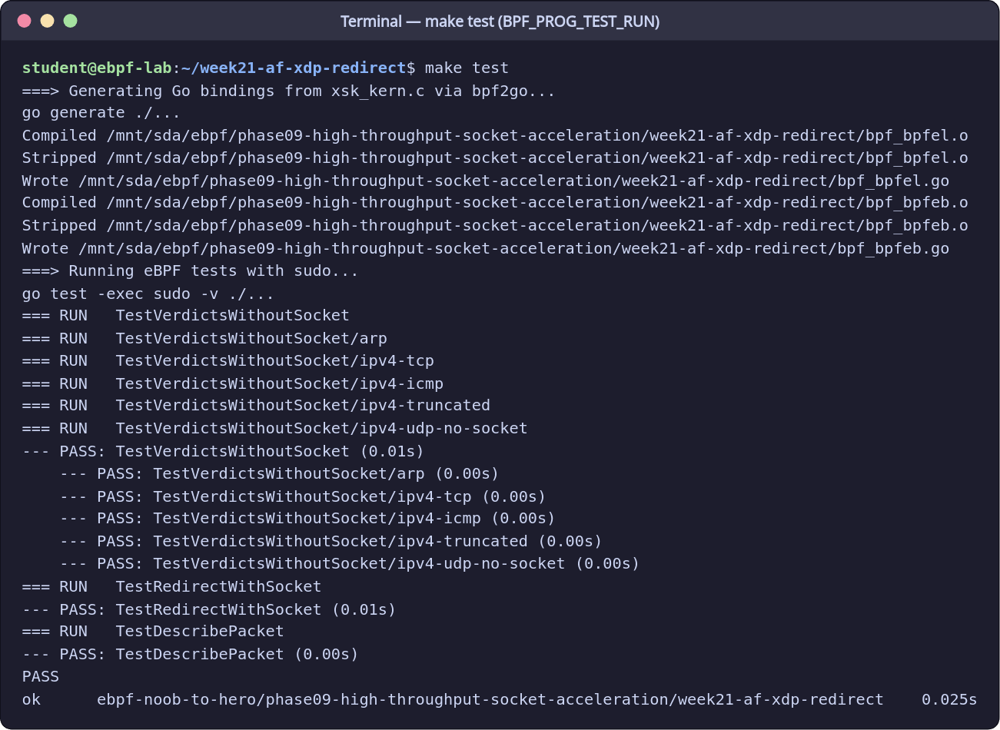
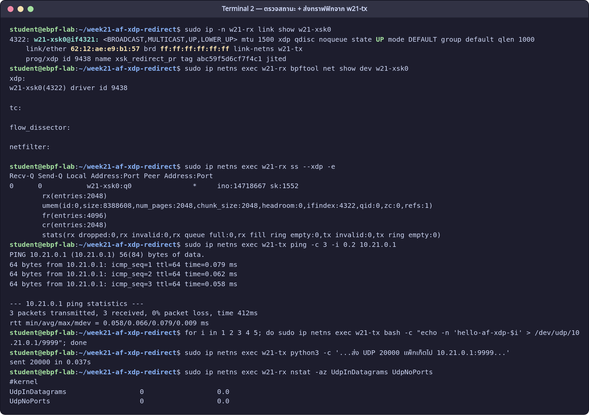
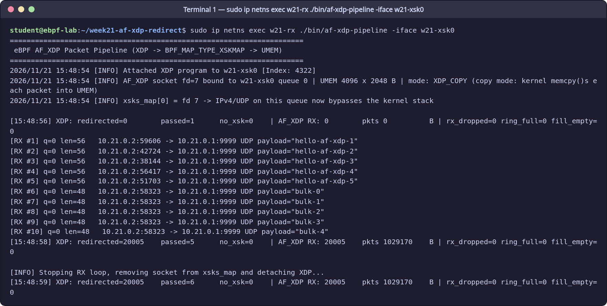
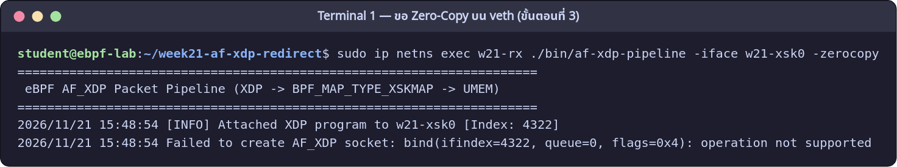

# Week 21: AF_XDP — ส่งแพ็กเก็ตจาก XDP เข้า User Space โดยตรงด้วย XSKMAP และ UMEM

**Week 21** — ส่งแพ็กเก็ตตรงเข้า User Space ด้วย XDP Redirect + AF_XDP

ใน Week 07 เราใช้ XDP ตัดสินใจ `XDP_DROP`/`XDP_PASS` ที่ระดับไดรเวอร์ แต่ถ้าเราต้องการ **ประมวลผลแพ็กเก็ตด้วยโปรแกรม User Space** (เช่น Load Balancer, Packet Capture, DNS Server ความเร็วสูง, NFV) โดยไม่ต้องผ่าน TCP/IP Stack และไม่ต้องใช้เฟรมเวิร์กที่ยึดการ์ดแลนทั้งใบแบบ DPDK — คำตอบของ Linux คือ **AF_XDP (Address Family XDP)**

สัปดาห์นี้เราจะ **เขียน AF_XDP Socket เองตั้งแต่ศูนย์ใน Go** (ใช้เพียง `golang.org/x/sys/unix`): สร้าง UMEM, Map Ring ทั้งหมดด้วย `mmap()`, Bind กับ Queue ของการ์ดแลน, ใส่ Socket ลงใน `BPF_MAP_TYPE_XSKMAP` แล้วรับแพ็กเก็ต UDP จริงผ่าน veth pair ใน Network Namespace

> [!NOTE]
> แล็บนี้รันใน **Copy Mode (`XDP_COPY`)** เพราะ veth ไม่รองรับ Zero-Copy (เราพิสูจน์ในหัวข้อ 4.3) และ **ไม่ได้วัดอัตราแพ็กเก็ตต่อวินาที (PPS)** — เป้าหมายคือเข้าใจกลไกให้ถูกต้อง ตัวเลขประสิทธิภาพของ AF_XDP ขึ้นกับการ์ดแลน ไดรเวอร์ และ CPU อย่างมาก

---

## 🗺️ แผนภาพภาพรวมการทำงาน (Workflow Overview)



> **สัญลักษณ์:** 🟥 Kernel Space · 🟦 User Space / เครื่องมือ · 🟨 BPF Map · 🟩 เครือข่าย (netns, veth, แพ็กเก็ต) · ◇ จุดตัดสินใจ

**อ่านแผนภาพ:** แล็บสร้าง veth pair ระหว่าง netns `w21-tx` (10.21.0.2) และ `w21-rx` (10.21.0.1) → `af-xdp-pipeline` แนบ `xsk_redirect_prog()` ที่ `w21-xsk0` แล้วสร้าง AF_XDP socket เอง (UMEM + FILL/COMPLETION/RX ring ผ่าน `mmap()`, bind queue 0 แบบ `XDP_COPY`) และใส่ fd ลงใน `xsks_map` → ทุกแพ็กเก็ตที่เข้ามา XDP ตรวจ header: ถ้าไม่ใช่ IPv4/UDP (เช่น ping) หรือยังไม่มี socket บน queue นั้นจะ `XDP_PASS` เข้า **TCP/IP Stack ปกติ**; ถ้าเป็น UDP และมี socket จะ `XDP_REDIRECT` **ข้าม Stack ทั้งหมด** ไปลง frame ใน UMEM และวาง descriptor บน RX ring → goroutine ฝั่ง Go `Poll()`/`Receive()` อ่านแพ็กเก็ตตรงจาก UMEM แล้วคืน frame กลับไปที่ FILL ring เพื่อรับรอบถัดไป ผลคือ `nstat` ใน `w21-rx` จะไม่เห็น UDP เหล่านี้เลย

### ⏱️ ลำดับเหตุการณ์ตามเวลา (Sequence Diagram)



**อ่านแผนภาพ:** user space และ kernel ไม่ส่งแพ็กเก็ตหากันผ่าน syscall แต่ผลัดกันขยับ index ของ ring ในหน่วยความจำร่วม: user space เป็นผู้ผลิตของ FILL ring (ส่ง frame ว่างให้) และเป็นผู้บริโภคของ RX ring (รับ frame ที่มีข้อมูล) ส่วน kernel ทำกลับกัน frame จึงวนใช้ซ้ำไม่รู้จบ ถ้า user space คืน frame ไม่ทัน FILL ring จะว่างและแพ็กเก็ตจะถูกทิ้งตั้งแต่ใน kernel

---

## 1. พื้นฐานและหลักการทำงาน (How It Works)

### 1.1 สถาปัตยกรรม AF_XDP



### 1.2 UMEM และ Ring ทั้ง 4

**UMEM** คือหน่วยความจำก้อนเดียวที่ User Space จองแล้ว "ลงทะเบียน" ให้เคอร์เนล แบ่งเป็น Chunk (Frame) ขนาดเท่ากัน (2048 หรือ 4096 ไบต์ในโหมด Aligned) แพ็กเก็ตทุกตัวจะอยู่ใน Frame ของ UMEM — ไม่มี `sk_buff`

| Ring | Producer | Consumer | เนื้อหา | ใช้ในแล็บ |
|------|----------|----------|---------|-----------|
| **FILL** | User | Kernel | `u64` Address ของ Frame ว่าง | ✔ |
| **RX** | Kernel | User | `struct xdp_desc {addr, len, options}` ของแพ็กเก็ตที่รับ | ✔ |
| **TX** | User | Kernel | `xdp_desc` ของแพ็กเก็ตที่จะส่ง | ✘ |
| **COMPLETION** | Kernel | User | Address ของ Frame ที่ส่งเสร็จแล้ว | สร้างไว้ (บังคับ) แต่ไม่ใช้ |

ทุก Ring เป็น **Single-Producer/Single-Consumer แบบ Lock-free**: แต่ละฝั่งเขียนเฉพาะ Index ของตัวเอง (`producer` หรือ `consumer`) และ Index เป็นตัวนับที่เพิ่มเรื่อย ๆ (ใช้ `idx & mask` หาตำแหน่งจริง ขนาดจึงต้องเป็นกำลังสอง) — กฎสำคัญคือ **เขียน Descriptor ให้เสร็จก่อน แล้วค่อย Store Producer** (Release) และ **Load Producer ก่อนอ่าน Descriptor** (Acquire) ซึ่งใน Go ใช้ `sync/atomic`

วงจรชีวิตของ Frame หนึ่งตัว: `FILL → (เคอร์เนลเขียนแพ็กเก็ต) → RX → (User ประมวลผล) → FILL → ...`

### 1.3 Copy Mode vs Zero-Copy Mode

| | `XDP_COPY` | `XDP_ZEROCOPY` |
|---|-----------|----------------|
| ข้อมูลเข้า UMEM อย่างไร | เคอร์เนล `memcpy()` จาก Buffer ของไดรเวอร์ลง Frame | การ์ดแลน DMA ลง UMEM โดยตรง |
| ต้องการอะไร | ทุกอินเทอร์เฟซที่รัน XDP ได้ (รวม Generic/SKB Mode) | ไดรเวอร์ต้อง Implement AF_XDP Zero-Copy (ผูก UMEM เป็น Buffer Pool ของ Queue) + Native XDP |
| ตัวอย่าง | veth, lo, การ์ดใดก็ได้ | ไดรเวอร์การ์ด 10/25/100G บางรุ่น เช่น Intel `i40e`/`ice`/`ixgbe`, NVIDIA `mlx5` (ตรวจสอบเอกสารไดรเวอร์และรุ่นเคอร์เนลของคุณ) |
| ถ้าไดรเวอร์ไม่รองรับ | — | `bind()` คืน `EOPNOTSUPP` |

ถ้า `bind()` โดยไม่ระบุ Flag ทั้งสอง เคอร์เนลจะลอง Zero-Copy ก่อนแล้วถอยไป Copy เอง — แล็บนี้ระบุ `XDP_COPY` ชัดเจน และให้ Flag `-zerocopy` ไว้ทดลอง ส่วนการตรวจว่าใช้โหมดไหนจริงทำได้ 2 ทาง: `getsockopt(XDP_OPTIONS)` (ฟังก์ชัน `IsZeroCopy()`) หรือ `ss --xdp -e` (ฟิลด์ `zc:0/1`)

> [!IMPORTANT]
> แม้จะเป็น Copy Mode AF_XDP ก็ยัง **ข้าม TCP/IP Stack ทั้งหมด** (ไม่มี `sk_buff`, ไม่มี Netfilter, ไม่มี Socket Lookup) — แต่ก็ไม่ควรเรียกว่า "Zero-Copy" และไม่ควรคาดหวังตัวเลขระดับเดียวกับ Zero-Copy บนการ์ดจริง

### 1.4 Socket ผูกกับ (ifindex, queue) — ทำไมคีย์ของ XSKMAP คือ Queue ID

AF_XDP Socket หนึ่งตัวรับได้จาก **RX Queue เดียว** ของอินเทอร์เฟซเดียว โปรแกรม XDP จึงใช้ `ctx->rx_queue_index` เป็นคีย์ของ XSKMAP ถ้า Redirect ไปยัง Socket ที่ Bind กับ Queue อื่น เคอร์เนลจะทิ้งแพ็กเก็ต บนการ์ดหลาย Queue (RSS) ต้องสร้าง Socket ต่อ Queue หรือใช้ `ethtool -N` (ntuple) บังคับทราฟฟิกเป้าหมายให้เข้า Queue ที่ต้องการ — veth ในแล็บนี้มี RX Queue เดียว (Queue 0)

### 1.5 `bpf_redirect_map()` และ Fallback Action

`bpf_redirect_map(&xsks_map, qid, XDP_PASS)` — บิตล่างของอาร์กิวเมนต์ `flags` คือ **Action ที่คืนเมื่อคีย์ไม่มี Socket** (เคอร์เนล 5.3 ขึ้นไป ตามที่ libbpf/libxdp ใช้ในโปรแกรม Default) ถ้าใส่ `0` จะได้ `XDP_ABORTED` ซึ่งทำให้แพ็กเก็ตหายระหว่างที่ User Space ยังไม่พร้อม การใช้ `XDP_PASS` ทำให้ระบบ "ล้มอย่างปลอดภัย" กลับไปใช้ Stack ปกติ

### 1.6 ทำไม Redirect เฉพาะ IPv4/UDP

ถ้า Redirect **ทุกแพ็กเก็ต** ARP Request ก็จะหายเข้า User Space → เคอร์เนลไม่ตอบ ARP → เครื่องอื่นหา MAC ไม่ได้ และส่งอะไรมาไม่ได้อีกเลย (รวมถึง SSH ถ้าเป็นการ์ดจริง!) แล็บนี้จึงเลือกเฉพาะ IPv4/UDP ส่วน ARP/ICMP/TCP ยังไปที่เคอร์เนล — `ping` จึงยังตอบได้ ขณะที่ UDP หายไปจากมุมมองของเคอร์เนลทั้งหมด (`UdpInDatagrams = 0` ในหัวข้อ 4.2)

### 1.7 เขียนเองหรือใช้ไลบรารี?

ไลบรารีอย่าง `libxdp` (C) หรือ `github.com/asavie/xdp` (Go) ห่อขั้นตอนทั้งหมดไว้ให้ ซึ่งเหมาะกับงานจริง แต่บทเรียนนี้เลือก **เขียนเอง ~270 บรรทัดใน `xsk.go`** เพราะ: (1) ทุก System Call ที่เป็นหัวใจของ AF_XDP มองเห็นได้ทีละขั้น (2) ไม่เพิ่ม Dependency นอกจาก `x/sys/unix` ที่มีอยู่แล้ว (3) ควบคุมได้ว่าใช้ `XDP_COPY` จริง ๆ เมื่อเข้าใจแล้ว การย้ายไปใช้ไลบรารีจะง่ายและรู้ว่าไลบรารีทำอะไรอยู่เบื้องหลัง

---

## 2. อธิบายโค้ดทีละบรรทัด (Line-by-Line Code Breakdown)

### 2.1 ไฟล์ `xsk_kern.c` (XDP Program)

```c
struct {
    __uint(type, BPF_MAP_TYPE_XSKMAP);
    __uint(max_entries, 64);
    __type(key, __u32);   /* Queue ID */
    __type(value, __u32); /* Socket FD */
} xsks_map SEC(".maps");
```
- **บรรทัด 16-21:** XSKMAP — User Space เขียน **FD ของ Socket** ลงไป แต่เคอร์เนลเก็บเป็นการอ้างอิง Socket (ฝั่ง User Space จึง `lookup` ค่ากลับไม่ได้ ได้ `Operation not supported`)

```c
enum {
    STAT_REDIRECTED  = 0,
    STAT_PASSED      = 1,
    STAT_NO_XSK      = 2,
    STAT_MAX,
};
```
- **บรรทัด 26-31:** ตัวนับ 3 ช่อง: Redirect สำเร็จ, ไม่ใช่ IPv4/UDP (ส่งเคอร์เนล), และเป็น UDP แต่ยังไม่มี Socket ใน Queue นี้

```c
    struct ethhdr *eth = data;
    if ((void *)(eth + 1) > data_end || eth->h_proto != bpf_htons(ETH_P_IP)) {
        stat_inc(STAT_PASSED);
        return XDP_PASS;
    }

    struct iphdr *iph = (void *)(eth + 1);
    if ((void *)(iph + 1) > data_end || iph->protocol != IPPROTO_UDP) {
        stat_inc(STAT_PASSED);
        return XDP_PASS;
    }
```
- **บรรทัด 57-67:** Bounds Check ตามกฎ Verifier (Week 07) แล้วกรองเฉพาะ IPv4/UDP (หัวข้อ 1.6)

```c
    __u32 qid = ctx->rx_queue_index;
    long ret = bpf_redirect_map(&xsks_map, qid, XDP_PASS);
    if (ret == XDP_REDIRECT) {
        stat_inc(STAT_REDIRECTED);
        return XDP_REDIRECT;
    }
    stat_inc(STAT_NO_XSK);
    return XDP_PASS;
```
- **บรรทัด 69-84:** ใช้ RX Queue ปัจจุบันเป็นคีย์ (หัวข้อ 1.4) และ Fallback เป็น `XDP_PASS` (หัวข้อ 1.5) นับ Redirect เฉพาะเมื่อ Helper คืน `XDP_REDIRECT` จริงเท่านั้น

### 2.2 ไฟล์ `xsk.go` (AF_XDP Socket แบบเขียนเอง)

```go
var DefaultXSKConfig = XSKConfig{
	NumFrames: 4096,
	FrameSize: 2048,
	FillSize:  4096,
	CompSize:  2048,
	RxSize:    2048,
}
```
- **บรรทัด 40-46:** ขนาดเริ่มต้นใกล้เคียงค่า Default ของ libxdp: UMEM 8 MiB, FILL Ring เท่ากับจำนวน Frame ทั้งหมด (มอบทุก Frame ให้เคอร์เนลตั้งแต่ต้น)

```go
	x.fd, err = unix.Socket(unix.AF_XDP, unix.SOCK_RAW, 0)
```
- **บรรทัด 116:** ขั้นที่ 1 — สร้าง Socket ตระกูล `AF_XDP` (ต้องเป็น root หรือมี `CAP_NET_RAW`)

```go
	x.umem, err = unix.Mmap(-1, 0, umemLen, unix.PROT_READ|unix.PROT_WRITE,
		unix.MAP_PRIVATE|unix.MAP_ANONYMOUS|unix.MAP_POPULATE)
	...
	reg := unix.XDPUmemReg{
		Addr:     uint64(uintptr(unsafe.Pointer(&x.umem[0]))),
		Len:      uint64(umemLen),
		Size:     cfg.FrameSize,
		Headroom: 0,
	}
	if err = setsockoptRaw(x.fd, unix.SOL_XDP, unix.XDP_UMEM_REG, unsafe.Pointer(&reg), unsafe.Sizeof(reg)); err != nil {
```
- **บรรทัด 122-135:** ขั้นที่ 2 — จอง UMEM ด้วย `mmap()` (Page-aligned และ **อยู่นอก Go Heap** จึงไม่ถูก GC ย้ายที่ — ห้ามใช้ `make([]byte)` เพราะเคอร์เนลจะ Pin หน้าหน่วยความจำนี้ไว้) แล้วลงทะเบียนด้วย `XDP_UMEM_REG` ผ่าน `setsockopt` แบบ Raw เพราะ `x/sys/unix` ไม่มี Wrapper สำหรับ Struct นี้

```go
	if err = unix.SetsockoptInt(x.fd, unix.SOL_XDP, unix.XDP_UMEM_FILL_RING, int(cfg.FillSize)); err != nil {
	...XDP_UMEM_COMPLETION_RING...
	...XDP_RX_RING...
```
- **บรรทัด 140-149:** ขั้นที่ 3 — กำหนดขนาด Ring (FILL และ COMPLETION บังคับต้องมีเสมอสำหรับ UMEM, RX หรือ TX ต้องมีอย่างน้อยหนึ่ง)

```go
	var off unix.XDPMmapOffsets
	if err = getsockoptRaw(x.fd, unix.SOL_XDP, unix.XDP_MMAP_OFFSETS, unsafe.Pointer(&off), unsafe.Sizeof(off)); err != nil {
	...
	if x.fill, err = mapRing(x.fd, unix.XDP_UMEM_PGOFF_FILL_RING, off.Fr, cfg.FillSize, 8); err != nil {
```
- **บรรทัด 151-163:** ขั้นที่ 4 — ถามเคอร์เนลว่า `producer`/`consumer`/`desc` อยู่ที่ Offset ใดในแต่ละ Ring แล้ว `mmap()` ด้วย Page Offset พิเศษ (`XDP_PGOFF_RX_RING`, `XDP_UMEM_PGOFF_FILL_RING`, `XDP_UMEM_PGOFF_COMPLETION_RING`) ฟังก์ชัน `mapRing()` (บรรทัด 88-103) สร้าง Pointer ไปยัง Index ทั้งสองและ Array ของ Descriptor

```go
	for i := uint32(0); i < cfg.NumFrames && i < cfg.FillSize; i++ {
		addrs = append(addrs, uint64(i*cfg.FrameSize))
	}
	x.fillFrames(addrs)
```
- **บรรทัด 166-170:** ขั้นที่ 5 — ใส่ Address ของ Frame ว่างลง FILL Ring **ก่อน Bind** เพื่อให้เคอร์เนลมีที่เขียนแพ็กเก็ตทันที (ถ้า FILL ว่าง ตัวนับ `fill_empty` จะเพิ่มและแพ็กเก็ตถูกทิ้ง)

```go
	flags := uint16(unix.XDP_COPY)
	if cfg.ZeroCopy {
		flags = unix.XDP_ZEROCOPY
	}
	if err = unix.Bind(x.fd, &unix.SockaddrXDP{Flags: flags, Ifindex: uint32(ifindex), QueueID: uint32(queue)}); err != nil {
```
- **บรรทัด 173-177:** ขั้นที่ 6 — Bind กับ (Interface, Queue) ตามโหมดที่เลือก

```go
	prod := atomic.LoadUint32(x.fill.producer)
	cons := atomic.LoadUint32(x.fill.consumer)
	free := x.fill.size - (prod - cons)
	...
	atomic.StoreUint32(x.fill.producer, prod+n)
```
- **บรรทัด 187-202 (`fillFrames`):** User Space เป็น Producer ของ FILL Ring: คำนวณช่องว่าง (`size - (prod - cons)` ใช้ได้แม้ Index จะ Overflow เพราะเป็นเลขคณิตแบบ `uint32`) เขียน Address แล้วจึงเลื่อน `producer`

```go
	cons := atomic.LoadUint32(x.rx.consumer)
	prod := atomic.LoadUint32(x.rx.producer) // load-acquire
	...
		handle(x.umem[d.Addr : d.Addr+uint64(d.Len)])
		x.recycle = append(x.recycle, d.Addr&^uint64(x.cfg.FrameSize-1))
	...
	atomic.StoreUint32(x.rx.consumer, cons+n)
	x.fillFrames(x.recycle)
```
- **บรรทัด 217-234 (`Receive`):** User Space เป็น Consumer ของ RX Ring: อ่าน Descriptor ทั้งหมดที่มี ส่ง Slice ที่ชี้ **เข้าไปใน UMEM โดยตรง** ให้ Callback (ไม่ Copy อีกรอบใน User Space) จากนั้นคืน Frame — `d.Addr` อาจรวม Offset ของ Headroom ภายใน Chunk จึงต้อง Mask กลับเป็นต้น Chunk ก่อนใส่ FILL Ring

- **บรรทัด 237-250:** `Stats()` อ่าน `XDP_STATISTICS` (rx_dropped, rx_ring_full, fill_ring_empty) และ `IsZeroCopy()` อ่าน `XDP_OPTIONS` เพื่อรายงานโหมดที่ใช้งานจริง
- **บรรทัด 253-269:** `Close()` Unmap Ring → ปิด Socket → Unmap UMEM

### 2.3 ไฟล์ `main.go`

```go
	ifaceName := flag.String("iface", "w21-xsk0", "Interface to attach XDP + AF_XDP to (use a veth inside a test netns)")
```
- **บรรทัด 68-71:** ค่าเริ่มต้นเป็น veth ของแล็บ (ไม่ใช่ `lo` หรือการ์ดจริง) พร้อม Flag `-queue`, `-zerocopy`, `-print`

```go
	xdpLink, err := link.AttachXDP(link.XDPOptions{
		Program:   objs.XskRedirectProg,
		Interface: iface.Index,
	})
	...
	xsk, err := NewXSK(iface.Index, *queueID, cfg)
	...
	if err := objs.XsksMap.Put(&key, &fd); err != nil {
```
- **บรรทัด 94-125:** ลำดับสำคัญ: (1) แนบ XDP (2) สร้าง/Bind Socket (3) ใส่ FD ลง XSKMAP — ก่อนขั้นที่ 3 UDP ทั้งหมดถูกนับเป็น `no_xsk` และส่งต่อให้เคอร์เนล

```go
	go func() {
		defer close(done)
		for !stop.Load() {
			ready, err := xsk.Poll(200)
			...
			xsk.Receive(func(pkt []byte) {
```
- **บรรทัด 132-152:** RX Loop ใน Goroutine แยก: `poll()` รอแพ็กเก็ตสูงสุด 200 ms (เพื่อเช็ค `stop` เป็นระยะ) แล้ว Drain RX Ring; `describePacket()` (บรรทัด 42-65) Parse Ethernet → IPv4 → UDP จาก Byte ใน UMEM

- **บรรทัด 159-168:** Dashboard รวม 3 มุมมอง: ตัวนับฝั่ง XDP (`xsk_stats`), ตัวนับฝั่ง User Space (`AF_XDP RX`), และตัวนับฝั่ง Socket ของเคอร์เนล (`XDP_STATISTICS`) — ถ้า `redirected` มากกว่า `AF_XDP RX` ให้ดู `rx_dropped`/`ring_full`/`fill_empty`
- **บรรทัด 175-181:** เมื่อกด Ctrl+C หยุด RX Loop ก่อน แล้วลบ Socket ออกจาก XSKMAP ก่อนปิด Socket และถอด XDP

### 2.4 ไฟล์ `main_test.go` (BPF_PROG_TEST_RUN)

- `craftPacket()` / `udpPacket()` สร้างแพ็กเก็ต Ethernet/IPv4/UDP ด้วยมือ
- `TestVerdictsWithoutSocket`: ARP, IPv4-TCP, IPv4-ICMP, IPv4 ที่ถูกตัดสั้น → `XDP_PASS` + `passed++`; IPv4-UDP เมื่อ XSKMAP ว่าง → `XDP_PASS` + `no_xsk++`
- `TestRedirectWithSocket`: ใส่ AF_XDP Socket ลง `xsks_map[0]` (Context ของ Test Run ใช้ `rx_queue_index = 0`) → UDP ได้ `XDP_REDIRECT`, ARP ยังได้ `XDP_PASS` (Test Run รายงานเฉพาะ Verdict ไม่ได้ส่งแพ็กเก็ตเข้า Socket จริง)
- `TestDescribePacket`: ทดสอบ Parser ฝั่ง Go (ไม่ต้องใช้ root)

---

## 3. ขั้นตอนการรันและทดสอบ (Step-by-Step Execution & Verification)

> [!CAUTION]
> **อย่าแนบโปรแกรมนี้กับการ์ดแลนจริงหรือ `lo` บนเครื่องที่ใช้งานร่วมกับผู้อื่น** — UDP ทั้งหมด (รวม DNS, DHCP, VPN) บน Queue นั้นจะหายเข้า User Space ใช้ Network Namespace + veth ตามขั้นตอนด้านล่างเสมอ

### ขั้นตอนที่ 1: คอมไพล์และรัน Test
```bash
cd phase09-high-throughput-socket-acceleration/week21-af-xdp-redirect
make all
make test     # go test -exec sudo -v ./...
```

### ขั้นตอนที่ 2: สร้าง Lab Network (2 namespaces + veth pair)
```bash
sudo ip netns add w21-rx            # ฝั่งที่รัน XDP + AF_XDP
sudo ip netns add w21-tx            # ฝั่งผู้ส่ง
sudo ip link add w21-xsk0 type veth peer name w21-peer0
sudo ip link set w21-xsk0 netns w21-rx
sudo ip link set w21-peer0 netns w21-tx
sudo ip -n w21-rx addr add 10.21.0.1/24 dev w21-xsk0
sudo ip -n w21-tx addr add 10.21.0.2/24 dev w21-peer0
sudo ip -n w21-rx link set lo up; sudo ip -n w21-rx link set w21-xsk0 up
sudo ip -n w21-tx link set lo up; sudo ip -n w21-tx link set w21-peer0 up
```

### ขั้นตอนที่ 3: (ทดลอง) ขอ Zero-Copy บน veth
```bash
sudo ip netns exec w21-rx ./bin/af-xdp-pipeline -iface w21-xsk0 -zerocopy
# คาดว่า: bind(...flags=0x4): operation not supported
```

### ขั้นตอนที่ 4: รัน Pipeline ใน Copy Mode (Terminal 1)
```bash
sudo ip netns exec w21-rx ./bin/af-xdp-pipeline -iface w21-xsk0
# หรือ: make run   (IFACE=w21-xsk0 NETNS=w21-rx)
```

### ขั้นตอนที่ 5: ตรวจสอบสถานะ (Terminal 2)
```bash
sudo ip -n w21-rx link show w21-xsk0                    # ต้องเห็น prog/xdp
sudo ip netns exec w21-rx bpftool net show dev w21-xsk0 # driver = Native XDP บน veth
sudo ip netns exec w21-rx ss --xdp -e                   # AF_XDP socket, umem, zc:0
```

### ขั้นตอนที่ 6: ส่งทราฟฟิกจากฝั่ง w21-tx
```bash
# ICMP -> XDP_PASS -> เคอร์เนลตอบ ping ได้ตามปกติ
sudo ip netns exec w21-tx ping -c 3 -i 0.2 10.21.0.1

# UDP -> XDP_REDIRECT -> AF_XDP socket
for i in 1 2 3 4 5; do
  sudo ip netns exec w21-tx bash -c "echo -n 'hello-af-xdp-$i' > /dev/udp/10.21.0.1/9999"
done

# UDP 20,000 แพ็กเก็ต
sudo ip netns exec w21-tx python3 -c '
import socket,time
s=socket.socket(socket.AF_INET,socket.SOCK_DGRAM)
t=time.time()
for i in range(20000): s.sendto(b"bulk-%d"%i,("10.21.0.1",9999))
print("sent 20000 in %.3fs"%(time.time()-t))'

# เคอร์เนลฝั่ง w21-rx ไม่เคยเห็น UDP เหล่านี้เลย (ถ้าเห็น UdpNoPorts จะเพิ่ม เพราะไม่มีใคร listen 9999)
sudo ip netns exec w21-rx nstat -az UdpInDatagrams UdpNoPorts
```

### ขั้นตอนที่ 7: หยุดโปรแกรมและล้างสภาพแวดล้อม
```bash
# Ctrl+C ที่ Terminal 1 แล้ว:
sudo ip netns del w21-rx
sudo ip netns del w21-tx     # veth ทั้งคู่ถูกลบตาม namespace
```

---

## 4. ผลลัพธ์จากการทดลองจริง (Actual Lab Execution Output)

> **Environment**: Ubuntu 26.04 LTS (`Linux 7.0.0-43-generic x86_64`), Intel Core i3-12100, clang 21, Go 1.26, cilium/ebpf v0.16.0

<!-- screenshots:begin -->

### 📸 ภาพหน้าจอจากการรันจริง (Real Terminal Screenshots)

> รันจริงบน `Linux 7.0.0-43-generic` (Ubuntu 26.04) เมื่อ 2026-11-21 ด้วยสคริปต์ [`scripts/screenshots/week21.sh`](../../scripts/screenshots/week21.sh) ทุกบรรทัดในภาพมาจากคำสั่งจริง (render เป็นภาพด้วย `scripts/screenshots/render.py`) ค่าอย่าง PID, เวลา และ latency จะเปลี่ยนทุกครั้งที่รัน

ภาพหน้าจออยู่ในหัวข้อย่อยที่ตรงกันด้านล่าง แทน output แบบข้อความเดิม

<!-- screenshots:end -->

### 4.1 `make test`



*ภาพ: `make test` — ทดสอบ Verdict ด้วย `BPF_PROG_TEST_RUN` ผ่านทุกกรณี*

### 4.2 Pipeline จริงบน veth (ขั้นตอนที่ 4-6)



*ภาพ: Terminal 2 — ตรวจสถานะ (`ip link`, `bpftool net`, `ss --xdp`) แล้วส่งทราฟฟิกจาก `w21-tx`*

**Output ของ `af-xdp-pipeline`:**



*ภาพ: Terminal 1 — `af-xdp-pipeline` รับแพ็กเก็ต UDP ผ่าน AF_XDP*

การอ่านผล:
- `redirected=20005` = 5 (hello) + 20,000 (bulk) และ `AF_XDP RX: 20005` ตรงกันทุกแพ็กเก็ต, `rx_dropped=0`
- `passed=5-6` คือแพ็กเก็ตที่ไม่ใช่ IPv4/UDP ซึ่งไปเคอร์เนลตามปกติ ได้แก่ ICMP Echo Request 3 ตัว และ ARP/IPv6 ที่อินเทอร์เฟซส่งเอง (เช่น Neighbor/Router Solicitation) — `ping` จึงได้ 0% loss
- `UdpInDatagrams = 0` และ `UdpNoPorts = 0`: เคอร์เนลไม่เคยเห็น UDP ทั้ง 20,005 ตัวเลย (ถ้าเห็นจะต้องตอบ ICMP Port Unreachable และเพิ่ม `UdpNoPorts`)
- `len=56` = Ethernet 14 + IPv4 20 + UDP 8 + Payload 14 ไบต์
- `ss` แสดง `zc:0` (Copy Mode) และ `bpftool net` แสดง `driver` = XDP รันใน Native Mode ของไดรเวอร์ veth
- ผู้ส่งเป็นสคริปต์ Python 20,000 แพ็กเก็ตใน 0.037 s — **ไม่ใช่การวัดขีดจำกัดของ AF_XDP** เป็นเพียงยืนยันว่ารับครบไม่ตกหล่นที่อัตรานี้

### 4.3 ขอ Zero-Copy บน veth (ขั้นตอนที่ 3)



*ภาพ: Terminal 1 — `af-xdp-pipeline -zerocopy` บน veth ถูกปฏิเสธด้วย `operation not supported`*

`flags=0x4` คือ `XDP_ZEROCOPY` — ไดรเวอร์ veth บนเคอร์เนล 7.0 ไม่รองรับ จึงคืน `EOPNOTSUPP` ตามหัวข้อ 1.3

---

## 5. ข้อจำกัด (Limitations)

- **Copy Mode เท่านั้นในแล็บ** — Zero-Copy ต้องใช้การ์ดแลนและไดรเวอร์ที่รองรับ (หัวข้อ 1.3) ไม่สามารถทดสอบบน veth ได้
- **รับอย่างเดียว (RX-only)** — สร้าง COMPLETION Ring ไว้เพราะเคอร์เนลบังคับ แต่ไม่มี TX Ring/การส่งแพ็กเก็ตกลับ
- **Socket เดียว Queue เดียว** — บนการ์ดหลาย Queue แพ็กเก็ตที่เข้า Queue อื่นจะเป็น `no_xsk` และไปเคอร์เนล
- **ขนาดแพ็กเก็ตสูงสุด** ถูกจำกัดด้วย Frame 2048 ไบต์ลบ Headroom ที่เคอร์เนลสำรอง (`XDP_PACKET_HEADROOM` 256 ไบต์) — Jumbo Frame ต้องใช้ Frame 4096 หรือ Multi-buffer (`XDP_USE_SG`) ซึ่งไม่ได้ Implement
- **ไม่ได้ใช้ `XDP_USE_NEED_WAKEUP` หรือ Busy Polling** และ Poll ทีละ Batch ใน Goroutine เดียว — เหมาะกับการเรียนรู้ ไม่ใช่การ Tune ประสิทธิภาพ
- **ไม่ได้วัด PPS/Throughput** — ตัวเลขประสิทธิภาพที่พบในบทความต่าง ๆ (หลายล้านแพ็กเก็ตต่อวินาทีต่อ Core) มาจาก Zero-Copy บนการ์ดจริงและโค้ดที่ Tune แล้ว ไม่ควรนำไปคาดหวังกับแล็บนี้
- **กรองเฉพาะ IPv4/UDP แบบหยาบ** — ไม่ดูพอร์ต, ไม่รองรับ VLAN/IPv6

---

## 6. Milestone Checklist

- [x] อธิบายสถาปัตยกรรม AF_XDP: XDP → XSKMAP → AF_XDP Socket → UMEM
- [x] เข้าใจบทบาทของ Ring ทั้ง 4 และโปรโตคอล Producer/Consumer แบบ Lock-free
- [x] สร้าง AF_XDP Socket เองด้วย `socket()`, `XDP_UMEM_REG`, Ring `setsockopt`, `XDP_MMAP_OFFSETS` + `mmap()`, และ `bind()`
- [x] แยกความแตกต่าง `XDP_COPY` กับ `XDP_ZEROCOPY` และพิสูจน์ได้ว่าใช้โหมดไหนจริง (`XDP_OPTIONS`, `ss --xdp`)
- [x] ใช้ `bpf_redirect_map(..., XDP_PASS)` ให้ล้มอย่างปลอดภัยเมื่อยังไม่มี Socket
- [x] รับแพ็กเก็ต UDP จริงผ่าน veth ใน Network Namespace และยืนยันว่าเคอร์เนลไม่เห็นแพ็กเก็ตเหล่านั้น
- [x] เขียน `BPF_PROG_TEST_RUN` Test ตรวจ Verdict ของ XDP ด้วยแพ็กเก็ตที่สร้างเอง

---

## 🛠️ การแก้ปัญหาที่พบบ่อย (Troubleshooting)

| อาการ | สาเหตุ / วิธีแก้ |
|---|---|
| `bind(...flags=0x4): operation not supported` เมื่อใส่ `-zerocopy` | ไดรเวอร์ `veth` (และ NIC เสมือนส่วนใหญ่) ไม่รองรับ AF_XDP Zero-Copy — ถอด `-zerocopy` ออกเพื่อรันใน Copy Mode (ค่าเริ่มต้น) ตามขั้นตอนที่ 4 |
| `no_xsk` เพิ่มขึ้นแต่ `AF_XDP RX` เป็น 0 | XDP ทำงานก่อนที่ socket จะถูกใส่ลง `xsks_map`, คีย์ Queue ID ไม่ตรง (`qid` ของ veth rx queue กับ socket), หรือรันหลาย queue โดยเปิด socket แค่ queue 0 |
| เผลอรันกับ NIC จริงหรือ `lo` ของโฮสต์แล้ว UDP (DNS/DHCP) ใช้ไม่ได้ | **อันตราย:** XDP redirect UDP ทั้งหมดเข้า user space — กด `Ctrl+C` เพื่อ detach ทันที และทดสอบเฉพาะใน namespace `w21-rx` / `w21-tx` |
| `fill_empty` เพิ่มขึ้นเมื่อยิง 20,000 UDP bursts เร็วๆ | user space โพสต์ frame กลับ FILL ring ไม่ทันจังหวะ burst ใน Copy Mode — เพิ่ม `-batch-size` หรือขนาด FILL ring ใน `DefaultXSKConfig` |

---

## 7. แบบฝึกหัดท้ายบท (Exercises)

### ระดับพื้นฐาน
1. **ทำให้ FILL Ring ว่าง:** แก้ `DefaultXSKConfig` ให้ `NumFrames: 64, FillSize: 64` และคอมเมนต์ `x.fillFrames(x.recycle)` ใน `Receive()` ออก แล้วส่ง UDP 20,000 แพ็กเก็ตเหมือนขั้นตอนที่ 6
   - *Deliverable:* Dashboard และ `ss --xdp -e`
   - *Verification:* `AF_XDP RX` หยุดที่ไม่เกิน 64, ตัวนับ `fill_empty`/`rx fill ring empty` เพิ่มขึ้น, `redirected` ยังเพิ่ม (XDP Redirect สำเร็จแต่ Socket ไม่มีที่วาง) — จากนั้นแก้กลับ
2. **Redirect ก่อนมี Socket:** คอมเมนต์บรรทัด `objs.XsksMap.Put(...)` ออก แล้วส่ง UDP
   - *Deliverable:* Dashboard + `nstat -az UdpNoPorts`
   - *Verification:* `no_xsk` เพิ่มขึ้น, `redirected = 0`, และ `UdpNoPorts` ของ w21-rx เพิ่มขึ้น (เคอร์เนลได้แพ็กเก็ตคืนตาม Fallback `XDP_PASS`)

### ระดับปานกลาง
1. **กรองตามพอร์ต:** เพิ่ม `BPF_MAP_TYPE_HASH` (key = UDP dst port) ให้ Redirect เฉพาะพอร์ตที่อยู่ใน Map และ Flag `-port 9999` ฝั่ง Go
   - *Deliverable:* โค้ด + Test Case ใหม่ใน `main_test.go` (พอร์ตตรง → `XDP_REDIRECT`, พอร์ตไม่ตรง → `XDP_PASS`)
   - *Verification:* `make test` ผ่าน และส่ง UDP ไปพอร์ต 9999 กับ 8888: มีเพียง 9999 ที่เข้า AF_XDP ส่วน 8888 ทำให้ `UdpNoPorts` เพิ่ม
2. **วัดอัตรารับแพ็กเก็ต:** เขียนผู้ส่ง UDP ใน Go (หรือใช้ `pktgen`/`trafgen`) ที่ส่งเร็วกว่า Python แล้ววัด PPS ที่ `AF_XDP RX` รับได้ เทียบกับ UDP Socket ปกติ (`net.ListenUDP`) ที่รับพอร์ตเดียวกันเมื่อไม่มี XDP
   - *Deliverable:* ตาราง PPS อย่างน้อย 3 รอบต่อกรณี พร้อม `rx_dropped`/`ring_full`
   - *Verification:* รายงานค่า min/median/max และอธิบายผลโดยคำนึงว่าเป็น Copy Mode บน veth

### ระดับท้าทาย
1. **UDP Echo ด้วย TX Ring:** เพิ่ม `XDP_TX_RING` + mmap (`XDP_PGOFF_TX_RING`) สลับ MAC/IP/Port ใน Frame เดิมแล้วส่งกลับ จัดการ COMPLETION Ring เพื่อคืน Frame และเรียก `sendto()` เพื่อ Kick เคอร์เนล
   - *Deliverable:* โค้ด + ผลจาก `ip netns exec w21-tx nc -u 10.21.0.1 9999` ที่ได้รับ Echo กลับ
   - *Verification:* `nc` ได้ข้อความกลับ, `ss --xdp -e` แสดง `tx(entries:...)` และ `tx invalid:0`, ตัวนับ Completion เท่ากับจำนวนแพ็กเก็ตที่ส่ง
2. **Multi-queue:** สร้าง veth ด้วย `numrxqueues 4 numtxqueues 4` สร้าง AF_XDP Socket หนึ่งตัวต่อ Queue (ใช้ `XDP_SHARED_UMEM` หรือ UMEM แยก) และใส่ทุกตัวลง XSKMAP
   - *Deliverable:* โค้ด + Dashboard แยกตาม Queue ขณะส่ง UDP จากหลาย Source Port
   - *Verification:* `ss --xdp` แสดง Socket ครบทุก `qid`, `no_xsk = 0`, และผลรวม RX ทุก Queue เท่ากับ `redirected`
